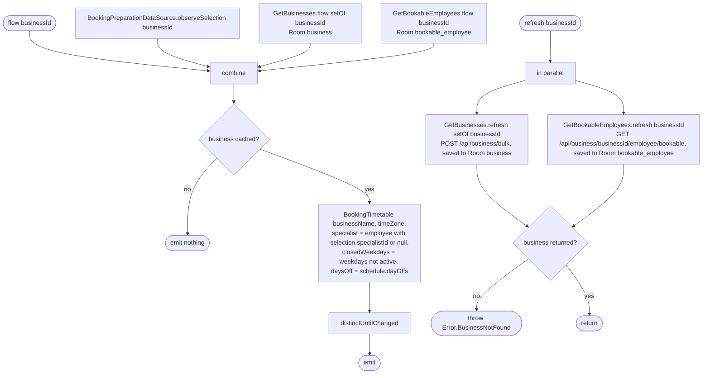

[← Operations](../README.md)

# Get booking timetable

`GetBookingTimetable.flow(businessId)` → local only · `GetBookingTimetable.refresh(businessId)` → business and
bookable employees from the backend · both used by `BookingDateTimeViewModel`; bound by `bookingDomainModule()`

`flow` names what the Date & time step shows above its title and the calendar its dates follow: the business name,
time zone, inactive weekdays and days off from the cached business (`GetBusinesses.flow`, Room `business`) and the
specialist picked on the previous step, looked up among the cached bookable employees (`GetBookableEmployees.flow`,
Room `bookable_employee`) by the id in the business's in-memory [booking preparation](get-booking-preparation.md).
Nothing is emitted until the business is cached; the specialist is `null` when the picked one is no longer bookable.
`BookingTimetable.isClosedOn(date)` tells whether the business is closed on a date; the timetable is passed to
[Get booking slots](get-booking-slots.md) so it does not look up the business again.

`refresh` fetches the business and its bookable employees in parallel and saves them to Room, so `flow` emits even when
the step opens without the business cached. When the backend returns no business it throws `Error.BusinessNotFound`
and the step leaves the booking flow.

