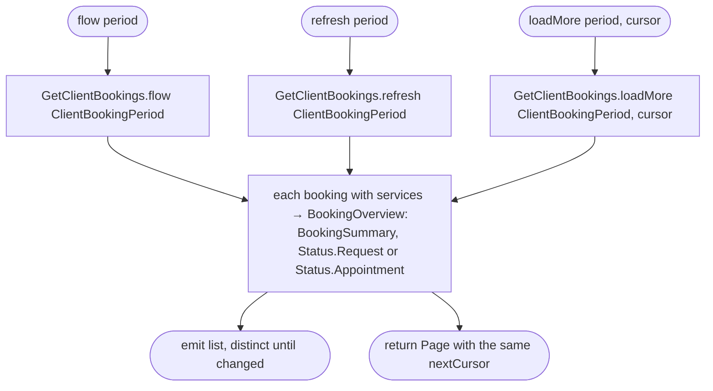

[← Operations](../README.md)

# Get bookings

`GetBookings.flow(period)` / `.refresh(period)` / `.loadMore(period, cursor)` → appointments' [Get client
bookings](../appointments/get-client-bookings.md) (`GET /api/appointments/mine` and `GET /api/appointments/request/mine`,
cached in Room `appointment`/`appointment_request`)
· called by `BookingsViewModel`, the Bookings screen of the client web app (one `ListPager` per period); bound by
`bookingDomainModule()`

Maps booking's `BookingPeriod` (`UPCOMING`, `PAST`) onto appointments' `ClientBookingPeriod` and each cached
booking into a `BookingOverview`: its id, the same `BookingSummary` as the details screens ([Get booking request
details](get-booking-request-details.md), [Get booking appointment details](get-booking-appointment-details.md))
and its status, a request's (waiting, confirmed, declined, closed) or an appointment's (confirmed, completed,
cancelled, missed), so a tap opens the matching details screen. Order and paging come from Get client bookings
unchanged; a booking without services (the backend never creates one) is left out.

