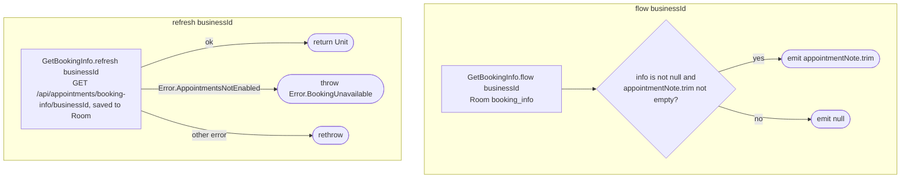

[← Operations](../README.md)

# Get business message

`GetBusinessMessage.flow(businessId)` / `GetBusinessMessage.refresh(businessId)` → appointments'
[Get booking info](../appointments/get-booking-info.md) (`GET /api/appointments/booking-info/{businessId}`)
· called by `BookingReviewViewModel`, which shows the message under "From <business>" and refreshes it when the Review
step opens; bound by `bookingDomainModule()`

The note the business wrote for clients, read from the `booking_info` row appointments caches in `ClientDatabase`.
`flow()` emits the trimmed note, or `null` when nothing is cached yet or the note is blank, so the step shows no
message box then. `refresh()` refreshes the cached row; `GetBookingInfo.Error.AppointmentsNotEnabled` becomes
`Error.BookingUnavailable`, on which the Review step says the business takes no online bookings and leaves the
booking flow. It only logs any other failed refresh: the message is supplementary, the cached one stays on screen, and
sending the request reports its own errors.

