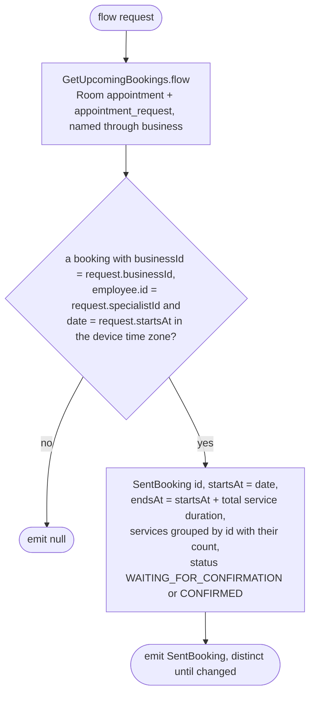

[← Operations](../README.md)

# Get sent booking

`GetSentBooking.flow(request)` → appointments' [Get upcoming bookings](../appointments/get-upcoming-bookings.md)
`flow()` (local only: Room `appointment` and `appointment_request`, named through `business`)
· called by `BookingSentViewModel`, which shows the sent request's card on the Request sent step; bound by
`bookingDomainModule()`

The backend answers `POST /api/appointments/request` with `204` and no body, so the client never gets the new request's
id. [Send booking request](send-booking-request.md) returns what identifies it instead (`SentBookingRequest`: business,
specialist and the time's start) and has already refreshed the upcoming bookings into Room. This use case finds the one
upcoming booking at that business with that specialist at that time; the backend refuses a second request for the same
time, so at most one matches. It compares the start in the device's time zone, the one `GetUpcomingBookings` converts a
request's time to. It emits `null` until the request is cached (the step shows no card then), and keeps emitting as
the cache changes, so the card's status follows the business's answer. The end is the start plus the services' total
duration; services booked more than once are listed once with their count. There is no `refresh()`: sending the request
already refreshed the upcoming bookings, and a failed refresh there is dropped.

