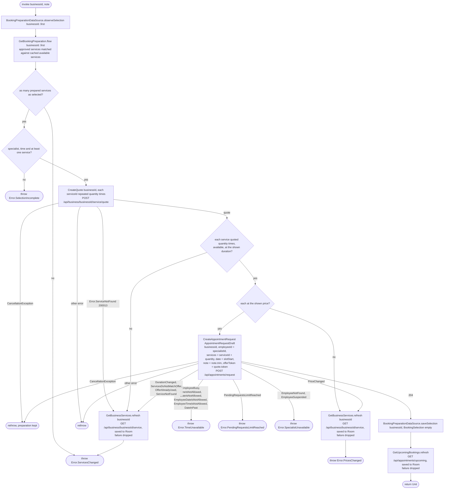

[← Operations](../README.md)

# Send booking request

`SendBookingRequest(businessId, note)` → services' [Create quote](../services/create-quote.md)
(`POST /api/business/{businessId}/service/quote`), then appointments'
[Create appointment request](../appointments/create-appointment-request.md) (`POST /api/appointments/request`), then appointments'
[Get upcoming bookings](../appointments/get-upcoming-bookings.md) refresh (`GET /api/appointments/upcoming`)
· called by `BookingReviewViewModel` when the client presses "Send request"; bound by `bookingDomainModule()`

Sends exactly what the Review step shows. It reads the business's [booking preparation](get-booking-preparation.md)
(the approved services matched against the cached, available services, with the prices and durations the summary
shows) and compares it with the raw in-memory selection: when a picked service is no longer offered, the summary has
dropped it, so it throws `Error.ServicesChanged` instead of sending a service the client never saw priced. When the
specialist, the time or every service is missing it throws `Error.SelectionIncomplete` without asking the backend,
and the Review step leaves the booking flow.

Otherwise it asks for a fresh quote, listing each service id once per unit (the quote signs the count per service),
and checks it against the preparation before using its token. A different count of a service, a service no longer
available or a changed duration throws `Error.ServicesChanged`; the same services at a different price throw
`Error.PricesChanged`. Neither sends, because the token would otherwise make the backend accept prices the client
never agreed to. In both cases, and when the backend answers the request itself with one of those changes, it
refreshes the business's services with services' `GetBusinessServices.refresh` (`GET /api/business/{businessId}/service`,
saved to Room) before rethrowing, so the cached services, and through them the preparation and the Review summary,
show the current prices: a repriced service then carries its new price beside the `approvedPrice` it was picked at,
and sending again approves the new price. A failed refresh is dropped (a cancellation passes through) and the
original error is thrown. Then it sends the request with the
quote's token, the counts, the time's start and the trimmed note. The quote is issued right before the request
because its token lives 10 minutes. Once the request is sent, the business's booking preparation is cleared, so the
next booking there starts from nothing; a failure keeps it, so the client can try again. A cancellation passes through
unchanged and also keeps the preparation. The backend answers the request with `204` and no body, so there is no
request to save: once it is sent, appointments' `GetUpcomingBookings.refresh` fetches the client's upcoming bookings
and saves them to Room (the new request lands in `appointment_request` as `PENDING`), so Home's
`appointmentRequestDao.observePending` shows it. A failed refresh is dropped (a cancellation passes through): the
request is already sent, and Home's next refresh picks it up.

The appointments and services errors are folded into the few the Review step tells apart, each shown as one popup.

