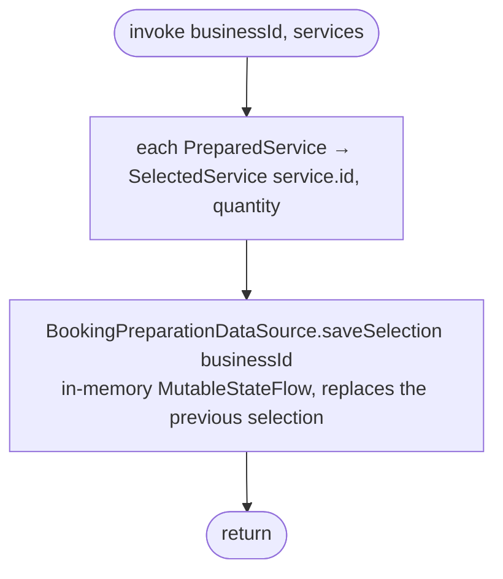

[← Operations](../README.md)

# Set booking services

`SetBookingServices(businessId, services)` → local only (`BookingPreparationDataSource`, in memory) · called from
`BookingServicesViewModel` when the client presses Continue; bound by `bookingDomainModule()`

Saves the services the client approved, with their counts and in their order, as the business's
[booking preparation](get-booking-preparation.md), replacing whatever was saved for that business before. Picks made
on the services step stay on the screen until Continue, so leaving without continuing keeps the last approved
services. Other businesses' preparations are untouched.

