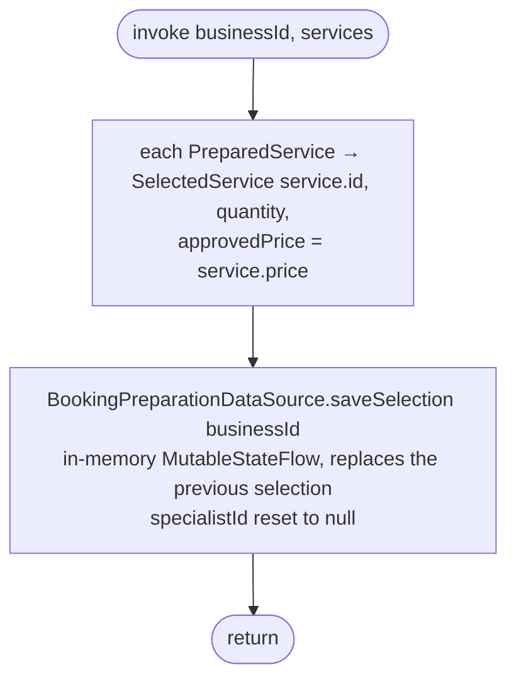

[← Operations](../README.md)

# Set booking services

`SetBookingServices(businessId, services)` → local only (`BookingPreparationDataSource`, in memory) · called from
`BookingServicesViewModel` when the client presses Continue; bound by `bookingDomainModule()`

Saves the services the client approved, with their counts, in their order and each with the price it was shown at
(`approvedPrice`, so the Review step can show a later price change beside it), as the business's
[booking preparation](get-booking-preparation.md), replacing whatever was saved for that business before, the specialist picked on the next step included
([Set booking specialist](set-booking-specialist.md)). Picks made
on the services step stay on the screen until Continue, so leaving without continuing keeps the last approved
services. Other businesses' preparations are untouched.

