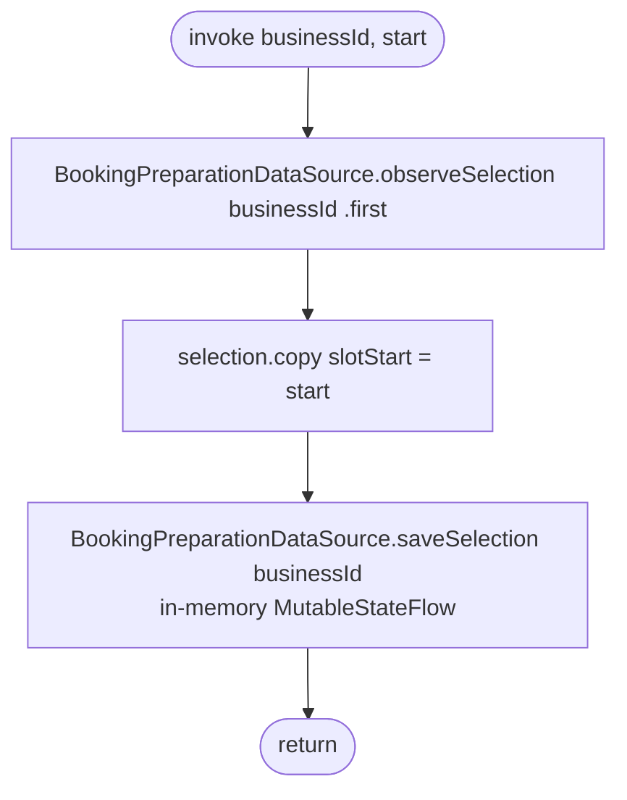

[← Operations](../README.md)

# Set booking slot

`SetBookingSlot(businessId, start)` → local only (`BookingPreparationDataSource`, in memory) · called from
`BookingDateTimeViewModel` when the client presses Continue on the Date & time step; bound by
`bookingDomainModule()`

Saves the start of the free slot the client picked as part of the business's
[booking preparation](get-booking-preparation.md), keeping the approved services and specialist. Picking another
specialist ([Set booking specialist](set-booking-specialist.md)) forgets it, and so does approving services again
([Set booking services](set-booking-services.md)). Other businesses' preparations are untouched.

