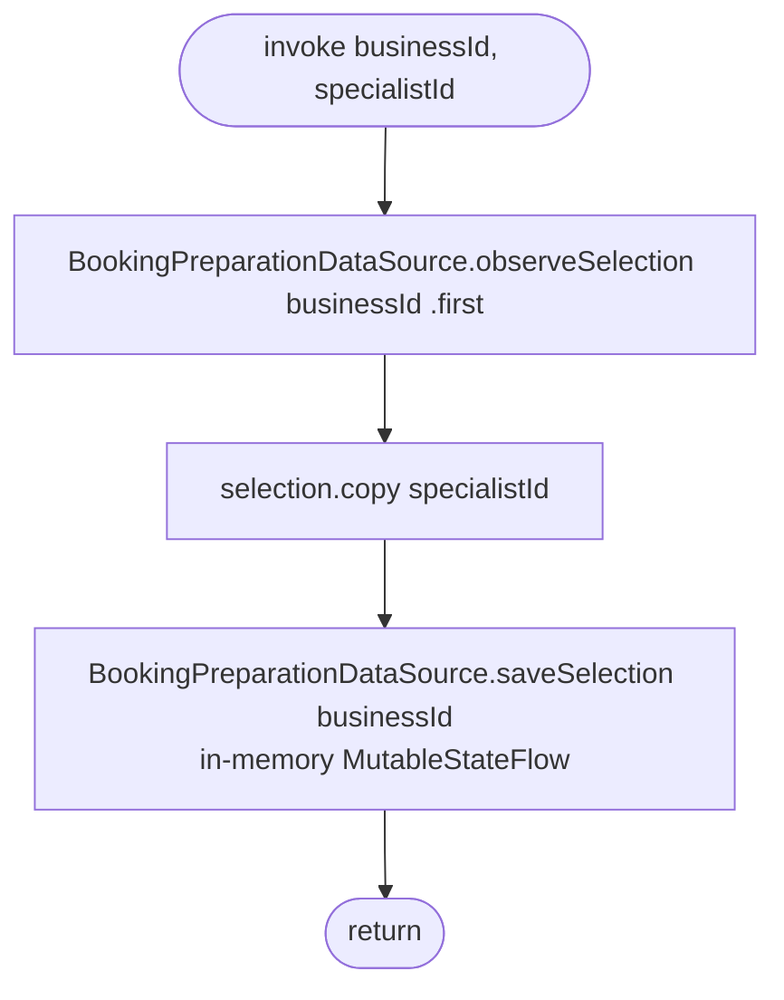

[← Operations](../README.md)

# Set booking specialist

`SetBookingSpecialist(businessId, specialistId)` → local only (`BookingPreparationDataSource`, in memory) · called
from `BookingSpecialistViewModel` when the client taps a specialist; bound by `bookingDomainModule()`

Saves the specialist the client picked as part of the business's [booking preparation](get-booking-preparation.md),
keeping the approved services and replacing any specialist picked before. Approving services again
([Set booking services](set-booking-services.md)) forgets it, since the specialist was picked for the old services.
Other businesses' preparations are untouched.

