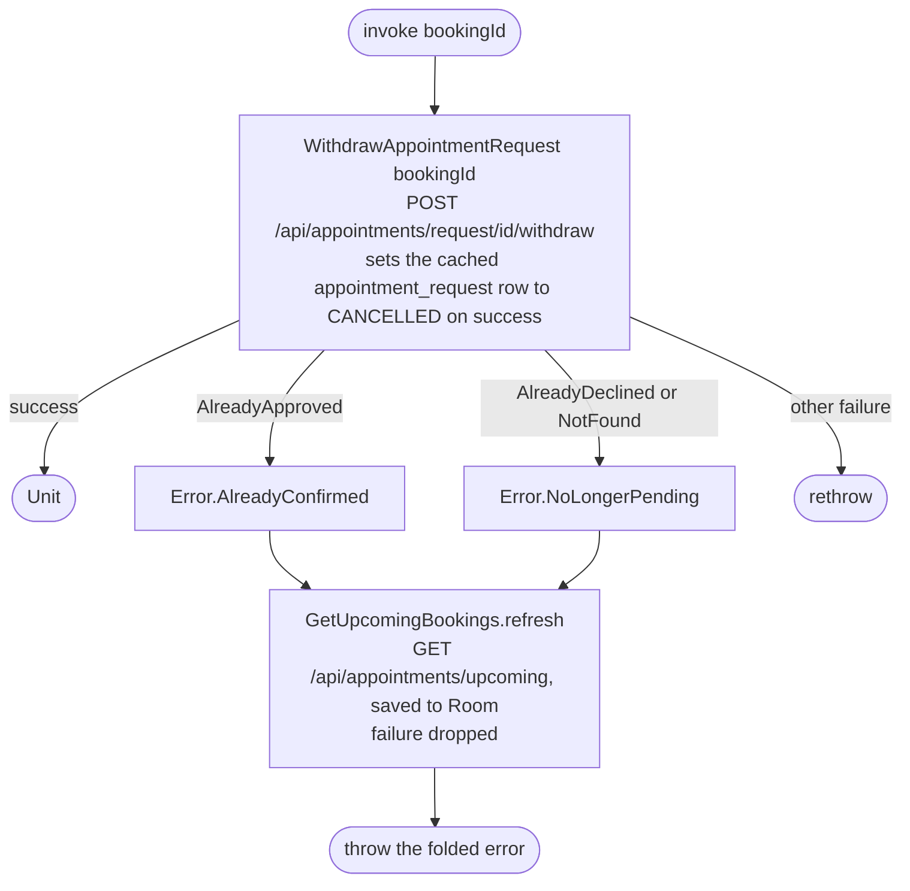

[← Operations](../README.md)

# Withdraw booking request

`WithdrawBookingRequest(bookingId)` → appointments' [Withdraw appointment
request](../appointments/withdraw-appointment-request.md) (`POST /api/appointments/request/{id}/withdraw`)
· called by `BookingRequestDetailsViewModel` when the client confirms the native "Withdraw request?" popup; bound by
`bookingDomainModule()`

Withdraws the pending request shown on the request details screen. On success the appointments use case has set the
cached request to `CANCELLED`, so [Get booking request details](get-booking-request-details.md) emits it as `CLOSED`
and Home, which lists pending requests only, drops it. When the business answered the request
before the client withdrew it, the cached pending request is stale: the error is folded into `AlreadyConfirmed`
(approved) or `NoLongerPending` (declined, expired or unknown to the backend), and the upcoming bookings are refreshed
first (`GetUpcomingBookings.refresh`, saved to Room; a failed refresh is dropped), so Home and Request sent show the
business's answer. Any other failure is rethrown without a refresh.

