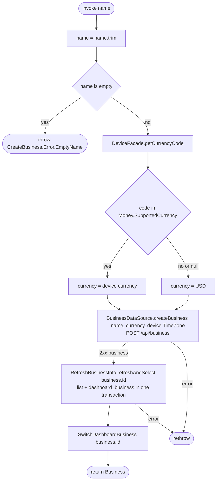

[← Operations](../README.md)

# Create business

`CreateBusiness(name)` → `POST /api/business`
· called from `BusinessDashboardViewModel` (business switcher) and `DashboardViewModel` (Home onboarding), each from a name input dialog

The name is trimmed first. A blank name throws `CreateBusiness.Error.EmptyName` before any network call.
The currency comes from the device region (`DeviceFacade.getCurrencyCode()`). If the device has no
currency, or its currency is not in `Money.SupportedCurrency`, the use case falls back to `USD`. The time zone is
taken from the device. The owner can change the currency later in Business settings. The created business is not written to the database directly. Instead the use case re-syncs the whole
business list selecting the new business in the same transaction (`RefreshBusinessInfo.refreshAndSelect`), so
the new row and its permission columns come from `GET /api/business/mine` and appear together with the
selection. [Switch dashboard business](switch-dashboard-business.md) then only tells the server; its local
write is a no-op because the business is already selected.

Composes [Refresh business info](refresh-business-info.md) and [Switch dashboard business](switch-dashboard-business.md).
