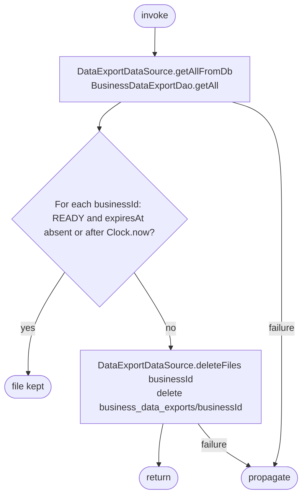

[← Operations](../README.md)

# Delete expired business data export files

`DeleteExpiredBusinessDataExportFiles()` → local only · called from
[Initial app data fetch](../authorization/initial-app-data-fetch.md) `timestampProtectedFetch` on every
app start, before its 30-minute throttle and authorization check.

It removes downloaded business JSON files whose export can no longer be downloaded, so a file does not
outlive its expiry when the export screen is never reopened. It reads every cached
`business_data_export` row and deletes `business_data_exports/<businessId>/` for each business whose
record is not READY with a future or absent expiry. No network request or database write is performed.

The expiry rule is `DataExport.isDownloadableAt`, shared with the screen and the personal export.
`InitialAppDataFetch` wraps the call in `runCatching`, so a file-system failure never blocks the startup
fetch. Files of businesses without a cached row cannot exist: rows and files are only removed together
(lost ownership and logout).
