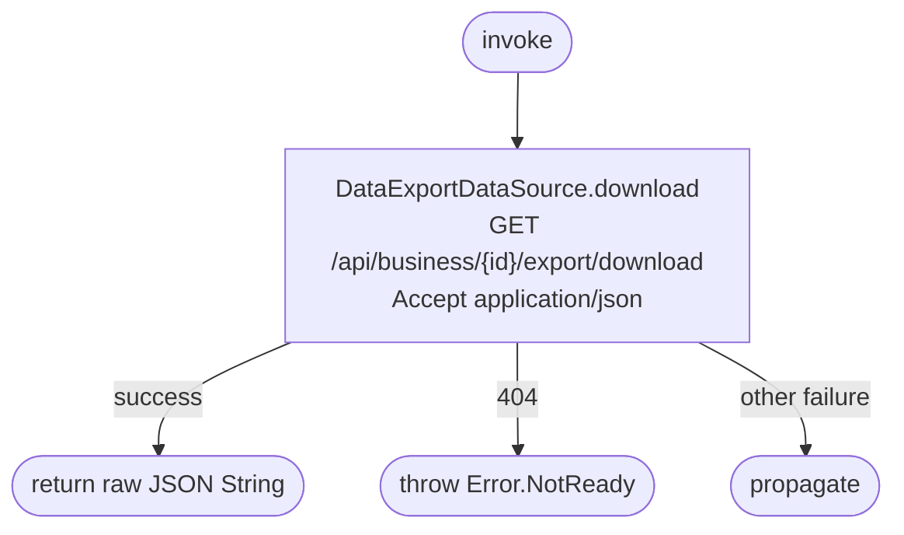

[← Operations](../README.md)

# Download business data export

`DownloadBusinessDataExport` → `GET /api/business/{id}/export/download`. No local persistence.

Returns the downloaded JSON unchanged; no export schema leaks into domain, no local file is created,
and no download data is cached. The caller owns subsequent saving/sharing. The backend permits repeat
downloads until expiry. For a business, 404 may also mean the caller is not the owner. Authentication
remains required; downloading does not prompt for another passkey.
