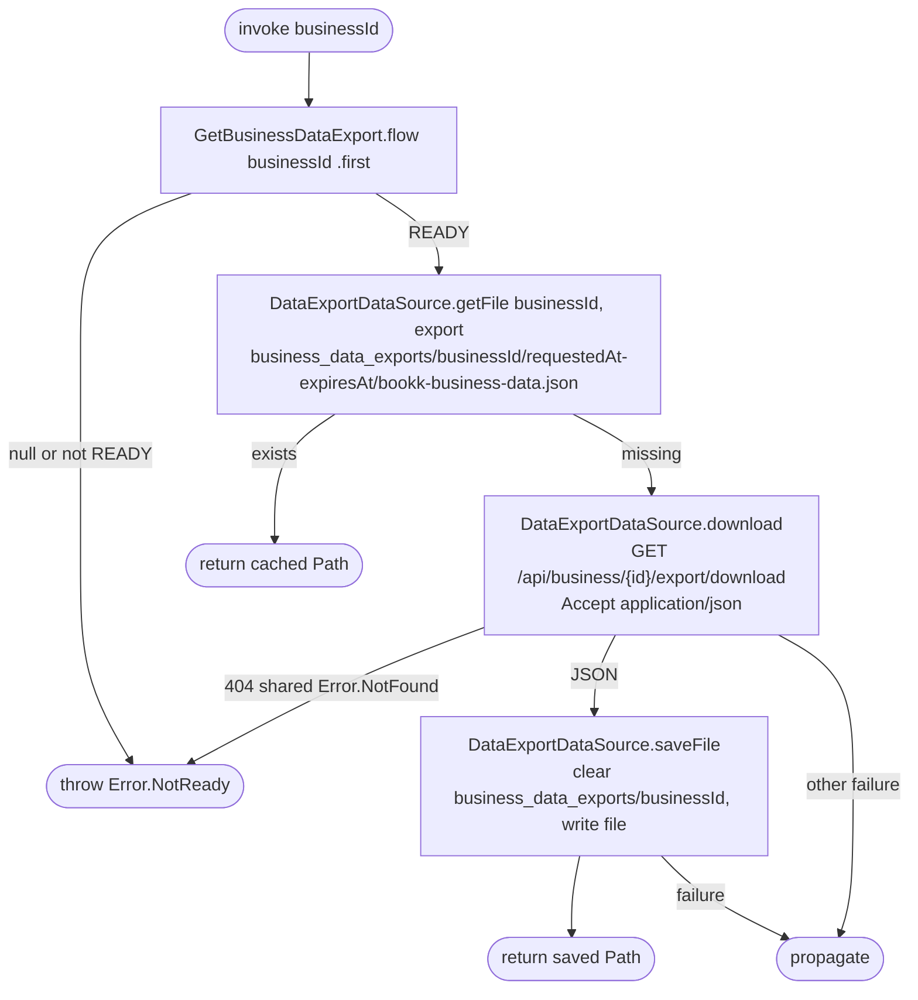

[← Operations](../README.md)

# Download business data export

`DownloadBusinessDataExport(businessId)` → local READY status, then cached file or
`GET /api/business/{id}/export/download`. Returns the JSON file path.

The downloaded JSON is written unchanged through `FileProvider`; no export schema leaks into the domain.
Files are keyed by business, request time and expiry, so a new export never reuses a stale file and
repeat downloads of the same export make no network call. Saving clears only that business's
directory. The ViewModel pushes `BusinessDataExportDestinations.Share(path)`; Android shares the file
through `BusinessDataExportFileProvider` (authority `<applicationId>.business_data_exports`, cache path
`business_data_exports/`), iOS through `ShareSheet`. Authentication remains required; downloading does
not prompt for another passkey.

For a business, 404 may also mean the caller is not the owner. The use case reports `NotReady`; the
ViewModel then offers a status refresh, which resolves the ambiguity through
[Get business data export](get-business-data-export.md) (`NotOwner` on 404).
