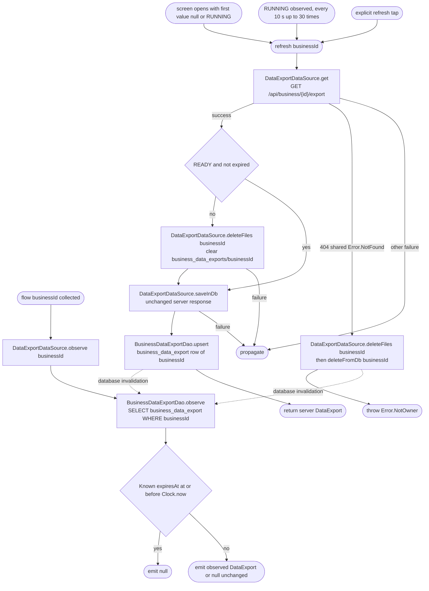

[← Operations](../README.md)

# Get business data export

`GetBusinessDataExport.flow(businessId)` observes the `business_data_export` row of one business.
It maps an expired record to `null` and emits other values unchanged. Observation is read-only: it
performs no network requests, file cleanup or database writes. `BusinessDataExportViewModel` invokes
`refresh(businessId)` when the screen opens with no usable cache (first observed value is null or
RUNNING), every 10 seconds (at most 30 times) while the observed status is RUNNING, and for explicit
refresh actions, using one operation key to exclude overlapping work.

Every cached emission is mapped using the injected clock: a known expiry at or before now emits `null`
for any status. Missing rows also emit `null`. Records with a future or absent expiry are emitted
unchanged. Statuses are `NONE`, `RUNNING`, `READY` and `FAILED`; `requestedAt`, `expiresAt` and
`availableAgainAt` are nullable backend timestamps, and the app neither infers expiry nor fabricates a
cooldown. The availability rule lives on `DataExport` (`isExpiredAt` / `isDownloadableAt`) and is shared
with the personal export.

`refresh()` always fetches the server status and saves the exact response through `saveInDb()`. When the
response is no longer downloadable, it first removes that business's export files. A failed network
request preserves local data; cleanup and cache-write failures propagate, and a cleanup failure skips
the save. The database observation is the only source of rendered state.

The backend answers 404 when the caller does not own the business. The shared HTTP mapper turns it into
`me.bookk.core.domain.entity.Error.NotFound`; the use case then forgets the cached status and the
downloaded file of that business, so a former owner keeps no copy of the business's data, and throws
`Error.NotOwner`. The ViewModel shows an owner-only message, hides every action and ignores later
observations of the forgotten row, so the request screen does not reappear.
