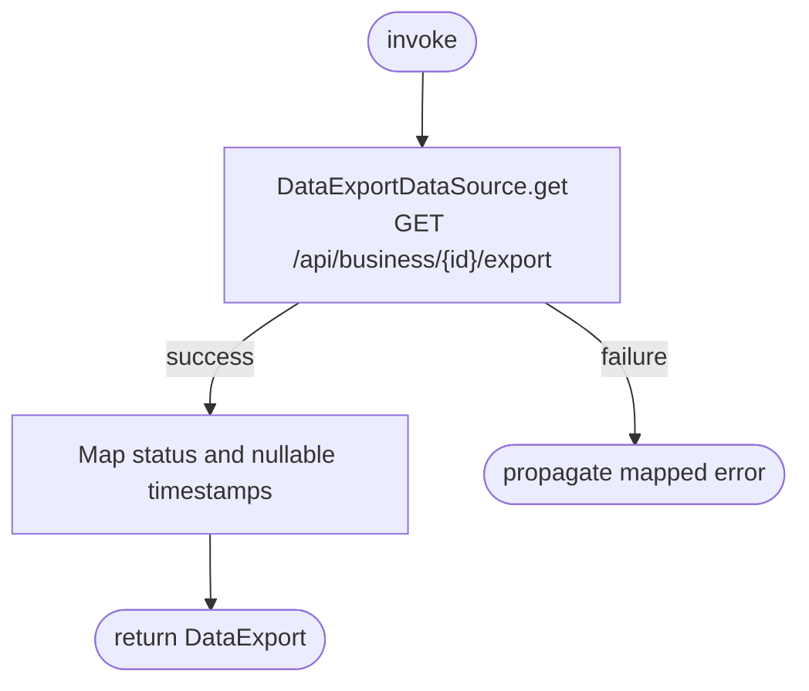

[← Operations](../README.md)

# Get business data export

`GetBusinessDataExport` → `GET /api/business/{id}/export`. No local persistence.

Statuses are `NONE`, `RUNNING`, `READY`, `FAILED`. `requestedAt`, `expiresAt` and `availableAgainAt` are
nullable backend timestamps; the app does not infer expiry or fabricate a cooldown.
