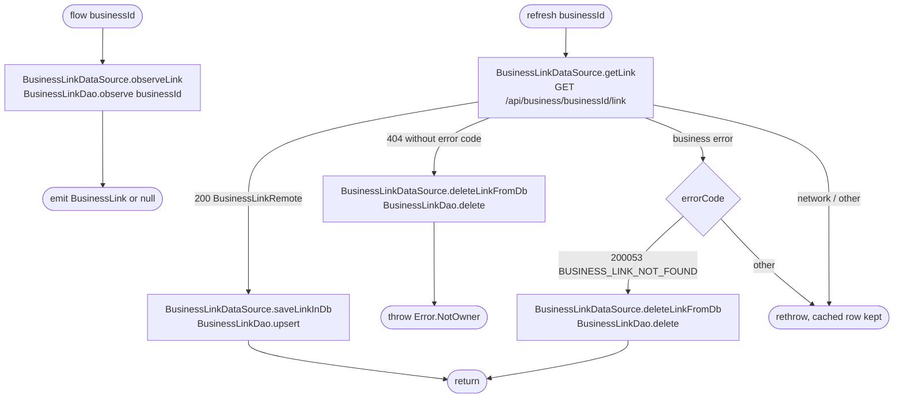

[← Operations](../README.md)

# Get business link

`GetBusinessLink.flow(businessId)` → `Flow<BusinessLink?>`, **local only**
· `GetBusinessLink.refresh(businessId)`, **network → Room**
· called from `BusinessLinkViewModel`: `flow()` when the screen opens, `refresh()` when it opens and on pull to refresh

Reads the business's current link name, opened by clients as `bookkme.com/{name}`. The screen renders only what
`flow()` emits from the `business_link` table, so a link fetched once stays visible offline. `refresh()` fetches
the link and upserts it. A business without a link answers `404` with `BUSINESS_LINK_NOT_FOUND`, which deletes
the cached row so the screen shows an empty name. A plain `404` without an error code means the caller can no
longer see the business (for example, after ownership changed while the dashboard still showed the owner's
tile): the cached row is deleted and `NotOwner` is thrown. Any other failure keeps the cached row and is
rethrown, and the screen shows it under the name field.

Saved through [Set business link](set-business-link.md). Table: [Business](../../database/business.md#business-link).
