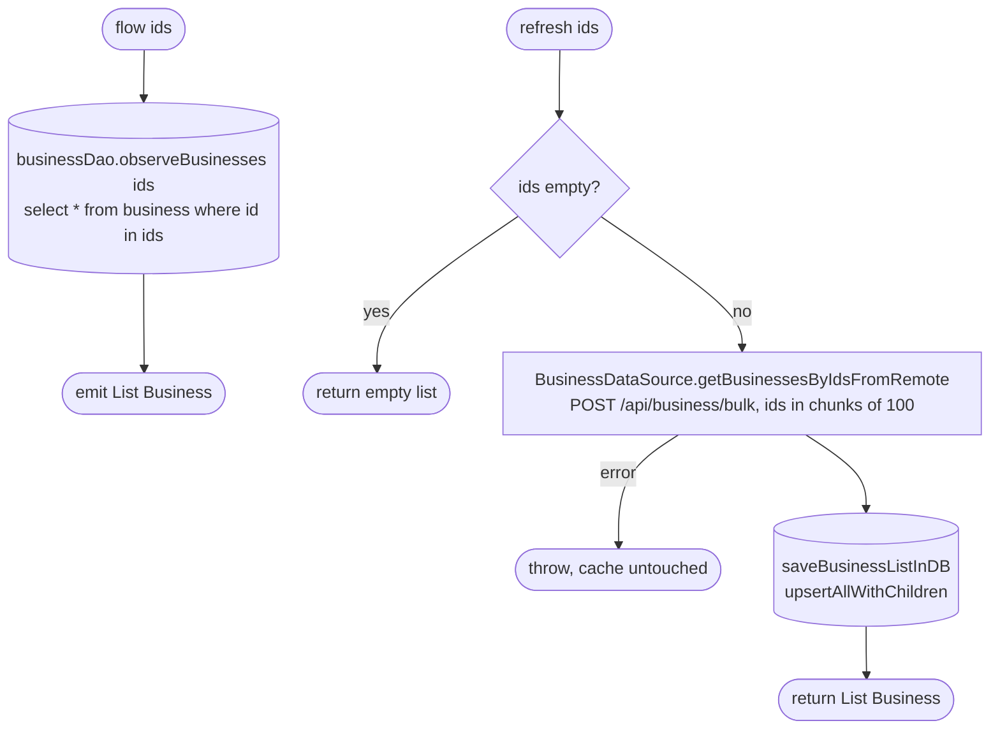

[← Operations](../README.md)

# Get businesses

`GetBusinesses.flow(ids)` / `.refresh(ids)` → `POST /api/business/bulk`
· called from `GetUpcomingBookings` and `GetSavedBusinesses` (client web app Home); bound only by `clientBusinessDomainModule()`

Reads up to 100 businesses at once with the caller's permissions, employee id and client id in each, like the single
business read. Ids with no business are left out and a repeated id is returned once. `CommonBusinessDataSource`
splits larger id sets into requests of 100, so `BUSINESS_BULK_READ_TOO_LARGE` (200054) cannot occur and has no
domain error. The businesses are saved with their schedules into `business` (`upsertAllWithChildren`), the same path
as [Refresh business info](refresh-business-info.md); nothing is deleted. That use case is a `DataFetchAction` that
deletes every business missing from `/business/mine`, which is why the client web app installs only
`clientBusinessDomainModule()` and `clientBusinessDataModule()`, never the full business modules.

