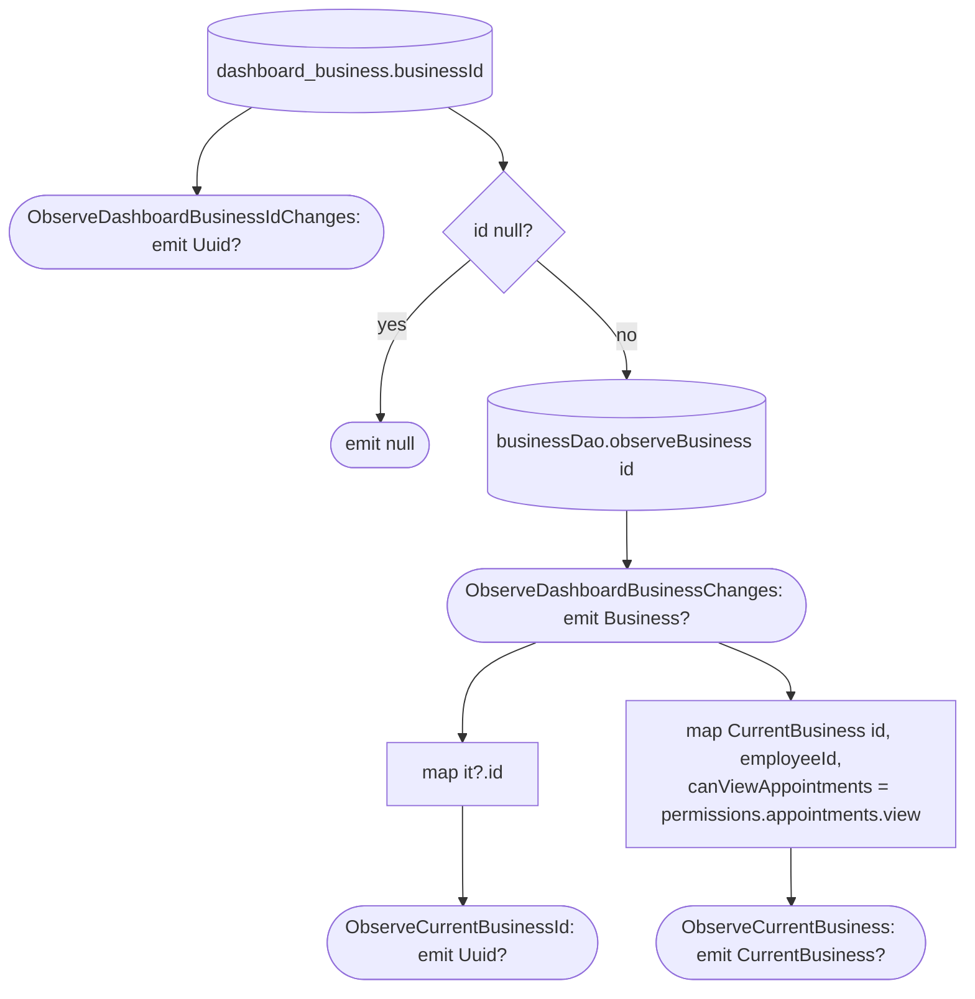

[← Operations](../README.md)

# Observe dashboard business (and its id)

The flows that every other feature uses to scope its data to the selected business. All of them are
**local only**.

| Use case | Returns | Callers |
|---|---|---|
| `ObserveDashboardBusinessIdChanges()` (business) | `Flow<Uuid?>`: raw `dashboard_business.businessId` | none at the moment |
| `ObserveDashboardBusinessChanges()` (business) | `Flow<Business?>`: the id joined to its `business` row | `BusinessSettingsViewModel`, every `Get*.flow()` list, [Get available dashboard features](get-available-dashboard-features.md), low-priority data fetch |
| `ObserveCurrentBusinessId()` (one copy each in appointments, clients, employees, services) | `Flow<Uuid?>`: `ObserveDashboardBusinessChanges().map { it?.id }` | list screens in those features |
| `ObserveCurrentBusiness()` (appointments) | `Flow<CurrentBusiness?>`: the business id with the caller's own `employeeId` (`null` while they are not an active employee) and `canViewAppointments` (`permissions.appointments.view`) | `AppointmentListViewModel`, which filters the list by that employee and shows a no-permission message instead of loading, and hides the new-appointment action, when `canViewAppointments` is false |

`ObserveCurrentBusinessId` is copied per feature so that each feature's `presentation` only depends on its own
`domain/api`. It maps from the **joined business row**, not the raw id. The selection has a foreign key to `business`, so
the id never points at an uncached business: it is written together with the row by [Refresh business
info](refresh-business-info.md), and cleared by cascade when the row is deleted.

