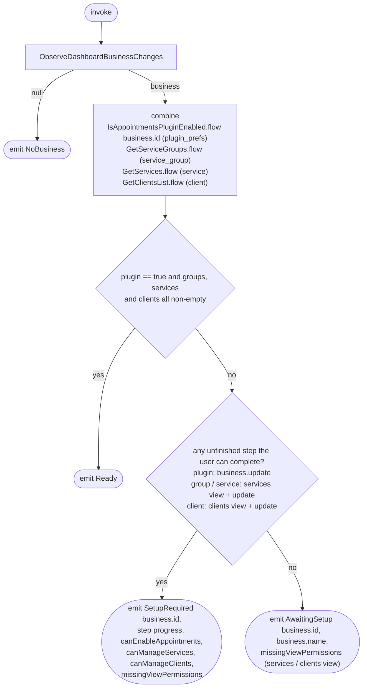

[← Operations](../README.md)

# Observe dashboard setup status

`ObserveDashboardSetupStatus()` → `Flow<DashboardSetupStatus>`, **local only**
· called from `DashboardViewModel`

Decides what the Home tab shows. It re-emits whenever the dashboard id, the business row, the plugin
preference, or the business's service groups, services or clients in Room change. This includes right after
[Create business](create-business.md) or [Join business](join-business.md), because both switch the dashboard
business.

A business is `Ready` only when all four onboarding steps are done: the appointments plugin is enabled, and
the business has at least one service group, one service and one client. The plugin flag counts as enabled
only when it is exactly `true`. `null` ("not fetched yet") is treated as disabled. Empty lists count as "not
done": the values come from Room only, so they are kept fresh by
[Refresh dashboard setup status](refresh-dashboard-setup-status.md).

Until then, the user's permission for each unfinished step decides what Home shows:

| Step | Permission |
|---|---|
| Create a service group, create a service | `permissions.services.view` and `permissions.services.update` |
| Create a client | `permissions.clients.view` and `permissions.clients.update` |
| Enable the appointments plugin | `permissions.business.update` (the Plugins screen checks it through `CanEditBusiness`) |

- **At least one unfinished step the user can complete** → `SetupRequired`. It carries the progress of each step
  (`isAppointmentsEnabled`, `hasServiceGroups`, `hasServices`, `hasClients`) and the three permissions
  (`canEnableAppointments`, `canManageServices`, `canManageClients`), so Home can render the checklist with the
  steps the user cannot complete disabled. Home lists the steps in this order: create a service group, create a
  service (locked until a group exists), create a client, enable the appointments plugin.
- **Only steps someone else has to complete** → `AwaitingSetup`, until all four are done.

Users without `permissions.clients.view` or `permissions.services.view` never get those lists synced, so the
steps for that resource always look unfinished to them. `business.update` only covers the business record, so
this is common: someone who may edit the business and turn on plugins often cannot view services or clients.
Both `SetupRequired` and `AwaitingSetup` carry `missingViewPermissions` (`CLIENTS`, `SERVICES`):

- On the checklist, the affected rows say which view permission is missing instead of their usual hint, and
  stay disabled.
- On the waiting screen, Home tells the user which view permission to ask the owner for instead of the regular
  "once the owner finishes setting it up" message.

