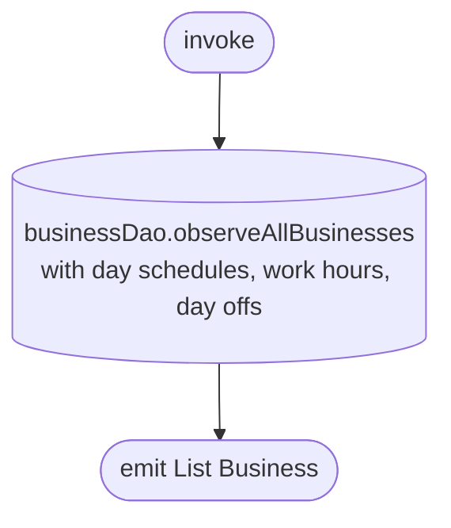

[← Operations](../README.md)

# Observe user businesses

`ObserveUserBusinessesChanges()` → `Flow<List<Business>>`, **local only** (`businessDao.observeAllBusinesses`)
· called from `BusinessDashboardViewModel` (business switcher). The Choose a business list on Home comes from
[Observe dashboard setup status](observe-dashboard-setup-status.md), which reads the businesses together with the
selection in one query instead.

Emits every row in `business`. Logout clears the table, so rows from a previous account never appear.
[Refresh business info](refresh-business-info.md) deletes businesses missing from the server's response, so
a business the user has left drops out of the list on the next refresh.

