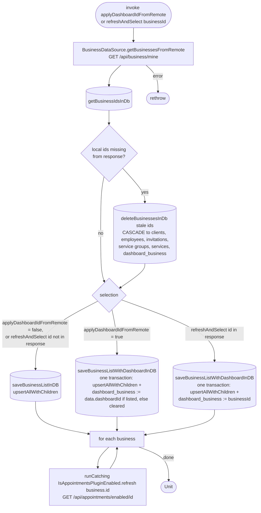

[← Operations](../README.md)

# Refresh business info

`RefreshBusinessInfo(applyDashboardIdFromRemote = false)` and `RefreshBusinessInfo.refreshAndSelect(businessId)`
→ `GET /api/business/mine`
· `invoke` is called from `DashboardViewModel`, [Initiate business suspend](../authorization/initiate-business-suspend.md)
and [Initial app data fetch](../authorization/initial-app-data-fetch.md); `refreshAndSelect` from
[Create business](create-business.md) and [Redeem employee invitation](../employees/redeem-employee-invitation.md)

Fetches every business the user owns or is an active employee of, together with the server-side dashboard
selection. Each business carries the caller's own standing in it: permissions, `employeeId` (their employee
record id, `null` while their access is suspended) and `clientId` (their client record id, if any). These are
stored on the `business` row like any other column. The selection
(`dashboard_business`) changes in the same Room transaction as the business list, so observers never see the
new rows without the new selection or the other way round:

- `invoke(applyDashboardIdFromRemote = true)`, only in `rawFetch()` right after sign-in or sign-up, selects the
  server's dashboard id, or clears the selection when that id is `null` or not among the returned businesses.
- `refreshAndSelect(businessId)` selects `businessId`. Create business and Redeem employee invitation use it so
  the new business row and its selection appear together, without a "Choose a business" frame in between. If
  the id is not among the returned businesses, the local selection is kept.
- `invoke(applyDashboardIdFromRemote = false)` keeps the local selection.

If the selected business is among the deleted ones below, the `dashboard_business` foreign key cascades and
clears the selection; the dashboard then shows Get started or Choose a business.

Businesses stored locally but missing from the response (the user left, was removed, or the business is gone)
are deleted with `deleteBusinessesInDb` before the list is upserted. The `business` foreign keys cascade that
delete to the business's clients, employees, invitations, service groups and services. Appointment tables only
reference the business logically and are not cleaned up. Nothing is deleted when the fetch fails.

Then the use case refreshes the plugin flag for every business one at a time, ignoring failures for each
business.

