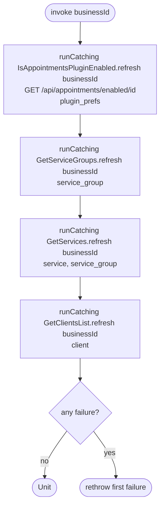

[← Operations](../README.md)

# Refresh dashboard setup status

`RefreshDashboardSetupStatus(businessId)` → `GET /api/appointments/enabled/{id}`, plus the service group,
service and client list fetches of the composed use cases
· called from `DashboardViewModel`

Re-fetches everything [Observe dashboard setup status](observe-dashboard-setup-status.md) reads,
so the onboarding checklist reflects the server and not a stale or never-synced cache. Sign-in already
refreshes these for the dashboard business through [Initial app data fetch](../authorization/initial-app-data-fetch.md),
but switching to another business does not. `DashboardViewModel` calls this once for each business id that it
sees in `SetupRequired` or `AwaitingSetup`, and ignores failures.

Each refresh runs even when an earlier one failed. After all four have run, the first failure is rethrown.

