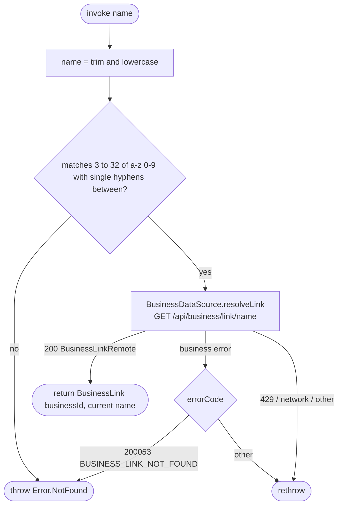

[← Operations](../README.md)

# Resolve business link

`ResolveBusinessLink(name)` → `BusinessLink`, **network only**
· called from `ClientHomeViewModel` (client web app, Telegram `startapp` launch parameter)

Finds the business behind a link name, so a `t.me/<bot>/<app>?startapp=<name>` launch opens and saves that business
(the ViewModel then calls [Save business](../appointments/save-business.md)). Trims and lowercases the name and
checks it against the link name rule (`BusinessLink.normalizeName`, `BusinessLink.isValidName`) before any request,
so a launch parameter that cannot be a link name fails without a round trip. The lookup needs no sign-in and is
rate limited by nginx (30 a minute per address). A name the business replaced within the last 90 days still finds it,
and the response carries the current name. Nothing is cached: it is a one-off lookup on launch, not screen data.

