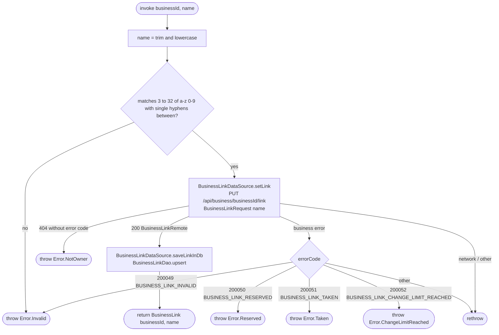

[← Operations](../README.md)

# Set business link

`SetBusinessLink(businessId, name)` → `BusinessLink`, **network → Room**
· called from `BusinessLinkViewModel` (Save)

Trims and lowercases the name (`BusinessLink.normalizeName`, which the screen's preview also uses) and checks it against the backend's rule (3 to 32 latin letters or digits,
single hyphens between them, `BusinessLink.isValidName`) before any request, so an invalid name fails without a round trip.
The screen uses the same `isValidName` to keep Save disabled until the typed name passes it. Only the
owner may set the link: the backend answers a plain `404` for anyone else, which becomes `NotOwner`.
The backend keeps a replaced name for 90 days (it still opens the business and no one else can take it)
and allows at most 3 changes within 90 days. The saved link is upserted into `business_link`, which the
screen observes through [Get business link](get-business-link.md); a failed save leaves the cached row as it was.

Read through [Get business link](get-business-link.md).
