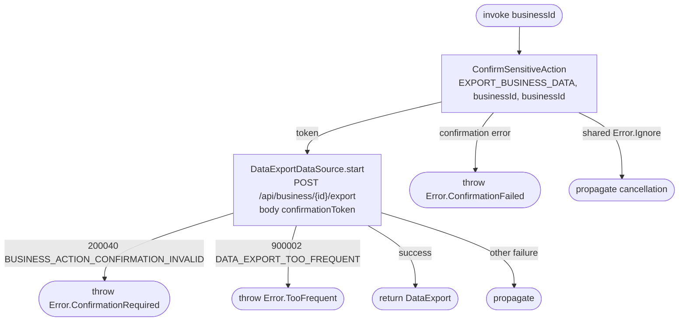

[← Operations](../README.md)

# Start business data export

`StartBusinessDataExport` → `POST /api/business/{id}/export`. No local persistence.

Passkey confirmation is bound to the exact export action and target. The backend builds JSON in the
background and enforces the daily limit; the operation does not poll, save tokens, or retry protected writes.
Use the status operation to inspect progress and cooldown. A confirmation token is single-use and expires
after two minutes. Shared cancellation errors propagate without starting an export.
