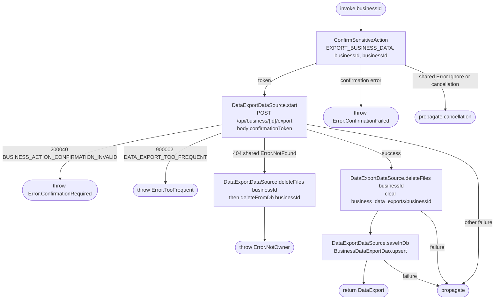

[← Operations](../README.md)

# Start business data export

`StartBusinessDataExport(businessId)` → `POST /api/business/{id}/export`.

Passkey confirmation is bound to the exact export action and target. The backend builds JSON in the
background and enforces the daily limit; a failed export can be started again at once. The operation does
not poll, keep tokens, or retry protected writes. A confirmation token is single-use and expires after two
minutes. Shared cancellation errors propagate without starting an export or writing the cache.

On success the previous export file of this business is deleted (the new export replaces it) and the
returned status is saved; the screen renders it through the
[status observation](get-business-data-export.md), not from the return value. Files and rows of other
businesses are untouched. A 404 means the caller does not own the business: the cached status and file
of that business are forgotten before `Error.NotOwner` is thrown.
