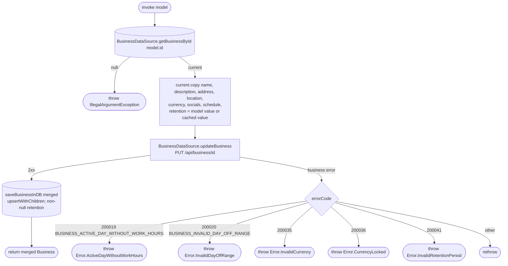

[← Operations](../README.md)

# Update business

`UpdateBusiness(model: Business.Update)` → `PUT /api/business/{id}`
· called from `BusinessSettingsViewModel`

Reads the cached business first and fails with `IllegalArgumentException` (`requireNotNull`) if it is not
cached. It copies the editable fields over the cached row, so fields that are not editable, such as the
permission columns and the time zone, are preserved. The PUT returns no body, so the **locally merged value**
is what gets written back to Room, not a server response.

`clientDataRetentionMonths` is persisted and sent in the update. A null value in `Business.Update`
preserves the cached period. Cached periods are non-null with a 36-month default.

Business Settings on Android and iOS displays the stored retention value in months and explains that
client details on ended appointments and requests are anonymized or deleted after that period.
The ViewModel accepts unsigned whole numbers in `ClientDataRetention.ALLOWED_MONTHS` (12 to 120 inclusive)
and disables Save while the value is invalid. Save runs under a `DropLatest` launch key, so a repeated
tap while a save is running is ignored. It handles
`InvalidRetentionPeriod` (200041) as an inline field error. Retention edits participate in save-button
and discard-confirmation state. The persisted and domain periods are non-null and default to 36 months, including rows migrated
from an older cache. The backend response model also carries non-null retention; mapping copies it
directly into the domain record. The mobile database is authoritative for retention;
saves continue sending the merged cached period with the other business fields.
The operation's network, cache writes and error mapping are unchanged.
