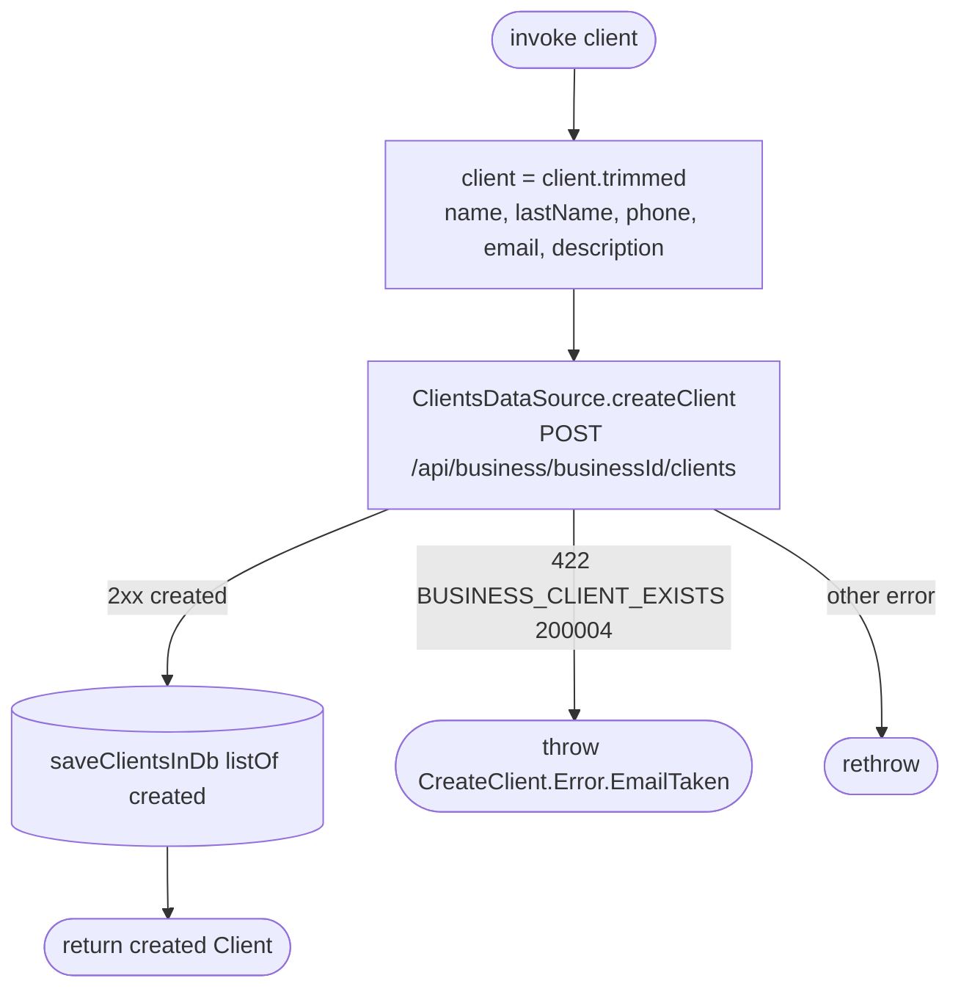

[← Operations](../README.md)

# Create client

`CreateClient(client)` → `POST /api/business/{businessId}/clients`
· called from `CreateClientViewModel`

Name, last name, phone, email and description are trimmed first (`Client.trimmed()`). The server does all validation (contact info, name, phone format, email already used by another client of the business). Several clients may share
a phone; only a taken email is rejected, with `BUSINESS_CLIENT_EXISTS` (200004), which maps to
`CreateClient.Error.EmailTaken`. `CreateClientViewModel` shows it inline on the email field and keeps
the form open; editing the email clears it. Every other failure is rethrown unchanged.

