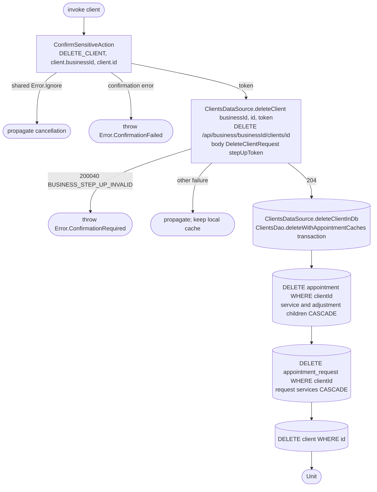

[← Operations](../README.md)

# Delete client with passkey confirmation

`DeleteClient(client)` confirms the action, deletes remotely, then invalidates local records.

Composes [Confirm sensitive action](../authorization/confirm-sensitive-action.md). A cancelled or failed
confirmation makes no DELETE request. A failed remote DELETE never removes local records. After success,
whole cached appointment/request aggregates referencing the deleted client are evicted, so personal
snapshots cannot linger in history or request lists. A later refresh can restore the backend's erased
versions. No anonymization values are invented locally. No schema version change is needed for these
DAO write-path changes, and logout behavior is unchanged.
