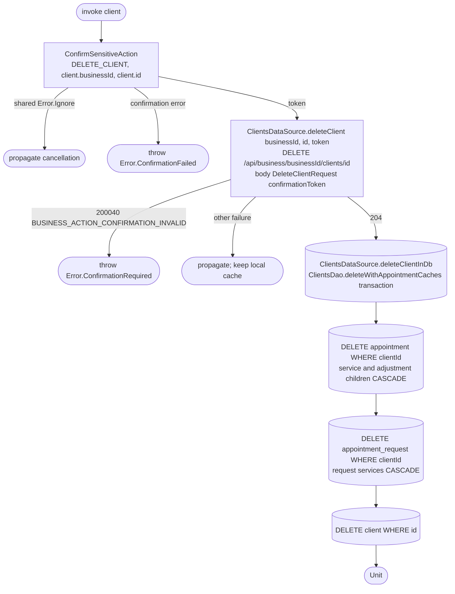

[← Operations](../README.md)

# Delete client with passkey confirmation

`DeleteClient(client)` confirms the action, deletes remotely, then invalidates local records.

Before invoking it, the Android and iOS edit screen shows the shared confirmation dialog explaining that
client deletion also erases personal data from the business's appointments, cannot be undone and needs
passkey confirmation. Cancel leaves the client unchanged. The delete action is visible to the business
owner for integrated clients, and follows the ordinary delete permission for detached clients; see
[Get clients permissions](get-clients-permissions.md). Successful deletion plays a success haptic and
returns to the client list; failure preserves the screen without a success haptic.

Composes [Confirm sensitive action](../authorization/confirm-sensitive-action.md). A cancelled or failed
confirmation makes no DELETE request. A failed remote DELETE never removes local records. After success,
whole cached appointment/request aggregates referencing the deleted client are evicted, so personal
snapshots cannot linger in history or request lists. A later refresh can restore the backend's erased
versions. No anonymization values are invented locally. No schema version change is needed for these
DAO write-path changes, and logout behavior is unchanged.
