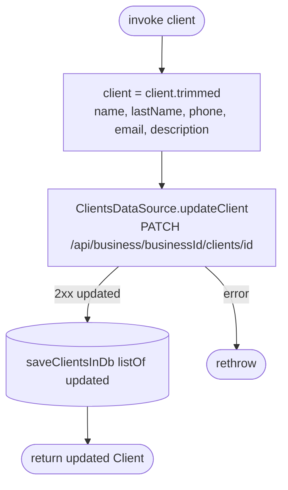

[← Operations](../README.md)

# Edit client

`EditClient(client)` → `PATCH /api/business/{businessId}/clients/{id}`
· called from `EditClientViewModel`

Name, last name, phone, email and description are trimmed first (`Client.trimmed()`). The route is sent as **PATCH**, matching the bookk-server swagger. Only non-null fields are updated. A phone or email already used by another client of the business is rejected with `BUSINESS_CLIENT_EXISTS` (200004), shown with the server message.

