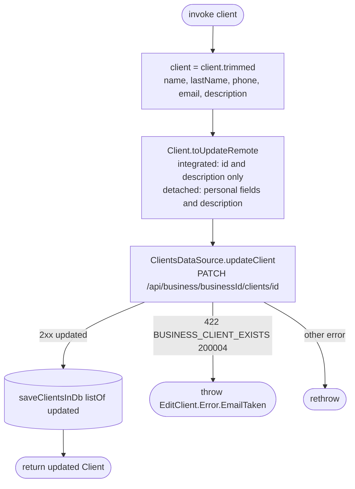

[← Operations](../README.md)

# Edit client

`EditClient(client)` → `PATCH /api/business/{businessId}/clients/{id}`
· called from `EditClientViewModel`

Name, last name, phone, email and description are trimmed first (`Client.trimmed()`). The route is sent as **PATCH**, matching the bookk-server swagger. Only non-null fields are updated. Several clients may share a phone; an email already used by another client of the business is rejected with `BUSINESS_CLIENT_EXISTS` (200004), which maps to `EditClient.Error.EmailTaken`. `EditClientViewModel` shows it inline on the email field and stays on the screen; editing the email clears it. Every other failure is rethrown unchanged.

Integrated clients never send name, last name, phone or email in the PATCH body, even if those values
are present in the domain snapshot. Those fields are owned by the linked user profile.
