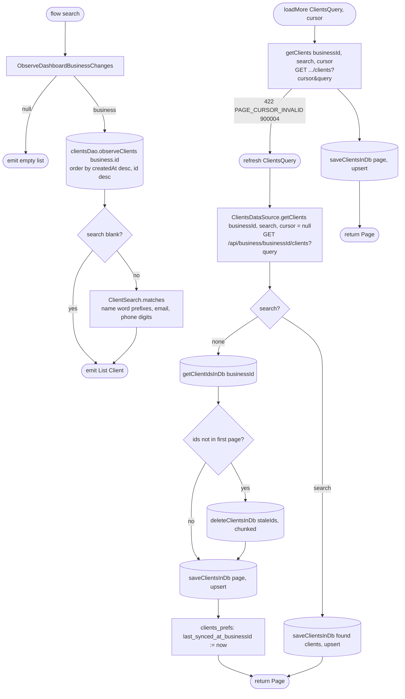

[← Operations](../README.md)

# Get clients list

`GetClientsList.flow(search)` / `.refresh(ClientsQuery)` / `.loadMore(ClientsQuery, cursor)` →
`GET /api/business/{businessId}/clients[?cursor=][&query=]`
· called from `ClientsListViewModel` and `SelectClientViewModel` (both through `SearchableClientList` and its `ListPager`),
[Refresh dashboard setup status](../business/refresh-dashboard-setup-status.md)
and [background data fetch](../authorization/initial-app-data-fetch.md)

`GetClientsList` is a `PagedSource<ClientsQuery, Client>`: `ClientsQuery(businessId, search)`. The route returns
one `ClientPage` (`data`, `nextCursor`, default 50 clients), newest first by the client's `createdAt` (field 8 of
`ClientRemote`, stored in `client.createdAt`), so the cache reads back in the same order.

- **Without a search** `refresh` reads the first page and replaces the cached clients of the business with it
  (stale-id delete, upsert, sync marker). Clients from later pages loaded before are dropped until the list scrolls
  to them again.
- **With a search** (2 characters or more, sent as `query`) the server finds clients whose first or last name
  starts with every query word (ignoring case, accents and apostrophes), or by a whole email or phone (digits only).
  `refresh` only adds those clients to the cache and keeps the rest.
- `loadMore` reads the page after the given cursor for the same query and adds it to the cache. A searched page can
  hold no clients and still carry a cursor; the screen's `ListPager` keeps paging until one has clients or the
  cursor is gone. A rejected cursor (`PAGE_CURSOR_INVALID` 900004) restarts from the first page through `refresh`.
- `flow(search)` emits the cached clients of the dashboard business, filtered on the device by `ClientSearch`: every
  query word starts a first- or last-name word (accents removed with `withoutDiacritics`, apostrophes dropped,
  case ignored), or the email contains the query, or, for a query of digits and ` +-().`, the phone digits contain
  the query digits. This matches at least everything the server search matches, so its results always show,
  while typing and offline it filters what is cached.

The use case keeps no paging state; the cursor and query of the next page live in the screen's `ListPager`.

