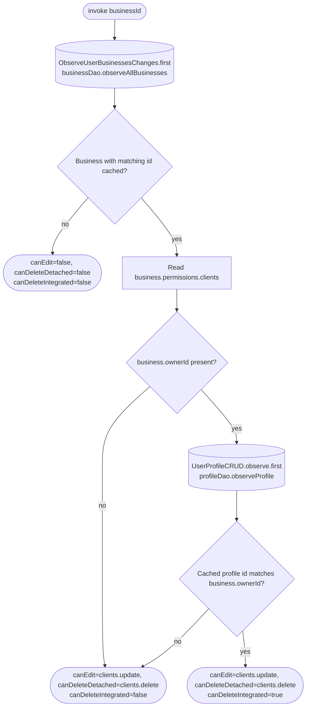

[← Operations](../README.md)

# Get clients permissions

`GetClientsPermissions(businessId)` → local only · called from `ClientsListViewModel`, `ClientDetailsViewModel` and `EditClientViewModel`

A wrapper in the clients domain keeps business and authorization dependencies out of clients presentation.
It takes the first emission of `ObserveUserBusinessesChanges`, finds the cached business and maps
`permissions.clients.update` and `permissions.clients.delete` to `canEdit` and `canDeleteDetached`.

For a cached business with an owner, it takes the first local emission of `UserProfileCRUD.observe()`
and compares the profile id with that business's `ownerId`. Only a match sets `canDeleteIntegrated`.
Ownership of another business grants nothing. Missing business, owner or profile never grants integrated
client deletion. A missing owner or profile preserves ordinary client grants; a missing business denies
all three permissions. No network request or cache write is performed.

- `ClientsListViewModel` re-checks permissions on every current-business change (keyed `launch`, so a
  stale result is dropped) and shows the add-client toolbar action only with `canEdit`.
- `ClientDetailsViewModel` shows the edit toolbar action only with `canEdit`.
- `EditClientViewModel` shows deletion for detached clients with `canDeleteDetached`, and for integrated clients
  with `canDeleteIntegrated`. The ownership check is independent of the delegated delete grant.

