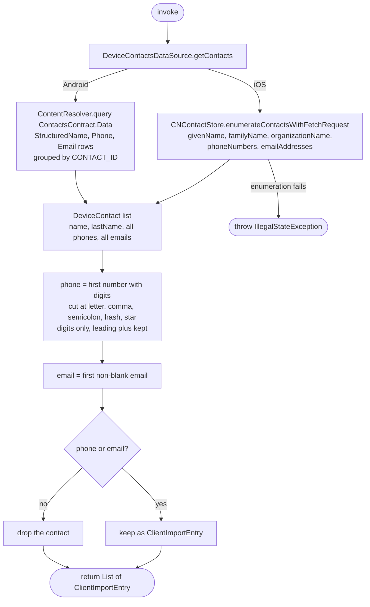

[← Operations](../README.md)

# Get device contacts

`GetDeviceContacts()` → local only (device address book) · called from `ClientsListViewModel`

Reads the phone book and turns each contact into a `ClientImportEntry`, ready for
[Import clients](import-clients.md). The caller must already hold the `CONTACTS` permission:
`ClientsListViewModel` calls `PermissionManager.requestPermission(CONTACTS)` when the import toolbar action is
tapped and calls this use case only when the permission is granted. Otherwise it shows the "Access to contacts" dialog
with an "Open settings" button. The contacts it returns are shown in the multi-select "Select contacts" picker
(`library/picker` `PickOptionScreen`), sorted by full name with the device locale's collation (`TextCollator`); a
contact without a name is shown by its phone, else its email. When no contact is left, the "No contacts to import"
message is shown instead of the picker. The picked contacts are passed to [Import clients](import-clients.md) for the current business.

`DeviceContactsDataSource.getContacts()` returns a `DeviceContact` with every phone and email of each contact, and has
one implementation per platform:

| | Android `AndroidDeviceContactsDataSource` | iOS `IosDeviceContactsDataSource` |
|---|---|---|
| Source | `ContentResolver.query(ContactsContract.Data)` for the `StructuredName`, `Phone` and `Email` rows, primary rows first, grouped by `CONTACT_ID` | `CNContactStore.enumerateContactsWithFetchRequest` |
| `name` | first non-blank `GIVEN_NAME`, else the contact's `DISPLAY_NAME_PRIMARY`, else `""` | `givenName`, else `organizationName` |
| `lastName` | first non-blank `FAMILY_NAME`, else `""` | `familyName` |
| `phones` | each `NORMALIZED_NUMBER` (E.164), else `NUMBER`, primary first | each `CNPhoneNumber.stringValue` |
| `emails` | each `ADDRESS`, primary first | each email |

The use case then maps each contact to a `ClientImportEntry`:

- `phone` is the first phone that has digits after cleaning. Cleaning cuts the number at the first letter (`ext.`),
  `,` or `;` (pause/wait), `#` or `*`, keeps only its digits (non-latin digits become `0–9`), and keeps a `+` only when
  it comes before the first digit: `+48 (500) 123-456 ext. 12` → `+48500123456`.
- `email` is the first non-blank email.
- A contact left with neither a phone nor an email is dropped, since the backend rejects it
  (`MISSING_CONTACT_INFO`).

Nothing else is trimmed or validated here. `ImportClients` trims each entry, and the backend rejects invalid ones.

