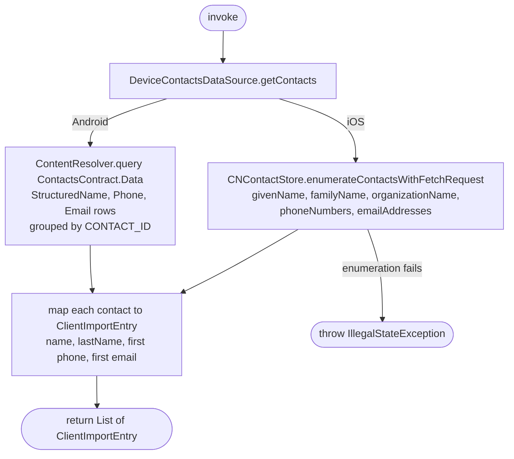

[← Operations](../README.md)

# Get device contacts

`GetDeviceContacts()` → local only (device address book) · called from `ClientsListViewModel`

Reads the phone book and turns each contact into a `ClientImportEntry`, ready for
[Import clients](import-clients.md). The caller must already hold the `CONTACTS` permission:
`ClientsListViewModel` calls `PermissionManager.requestPermission(CONTACTS)` when the import toolbar action is
tapped and calls this use case only when the permission is granted. Otherwise it shows the "Access to contacts" dialog
with an "Open settings" button. The contacts it reads are not used yet (ISSUE-112).

`DeviceContactsDataSource.getContacts()` has one implementation per platform:

| | Android `AndroidDeviceContactsDataSource` | iOS `IosDeviceContactsDataSource` |
|---|---|---|
| Source | `ContentResolver.query(ContactsContract.Data)` for the `StructuredName`, `Phone` and `Email` rows, primary rows first, grouped by `CONTACT_ID` | `CNContactStore.enumerateContactsWithFetchRequest` |
| `name` | first non-blank `GIVEN_NAME`, else the contact's `DISPLAY_NAME_PRIMARY`, else `""` | `givenName`, else `organizationName` |
| `lastName` | first non-blank `FAMILY_NAME`, else `""` | `familyName` |
| `phone` | first `NORMALIZED_NUMBER` (E.164), else `NUMBER`, else `null` | first non-blank `CNPhoneNumber.stringValue`, else `null` |
| `email` | first `ADDRESS`, else `null` | first non-blank email, else `null` |

Nothing is trimmed or validated here. `ImportClients` trims each entry, and the backend rejects invalid ones.

