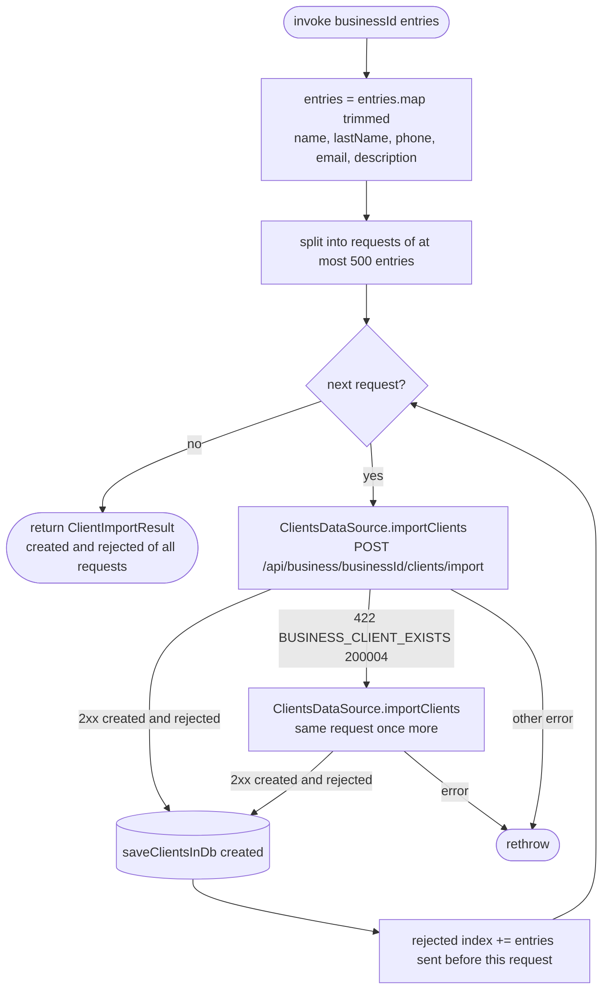

[← Operations](../README.md)

# Import clients

`ImportClients(businessId, entries)` → `POST /api/business/{businessId}/clients/import`
· called from `ClientsListViewModel` with the contacts picked in the "Select contacts" picker (see
[Get device contacts](get-device-contacts.md))

Creates detached clients in bulk, e.g. from the phone book. While it runs, `ClientsListViewModel` disables the
import toolbar action; it re-enables it when the call ends, plays the success haptic on success and shows the error
otherwise. The created clients appear in the list through the clients `flow()`, since each request saves them to the DB. Each entry's name, last name, phone,
email and description are trimmed first (`ClientImportEntry.trimmed()`). The backend accepts at most
500 entries per request (`BUSINESS_CLIENT_IMPORT_TOO_LARGE` 200039), so the entries are sent in
requests of up to 500, one after another. Valid entries are created; the backend returns every other
entry in `rejected` with its position in that request and an error code, which
`RejectedClientRemote.toDomain()` maps to `RejectedClientImport.Reason`:

| Backend code | Reason |
|---|---|
| `BUSINESS_CLIENT_NAME_VALIDATION_ERROR` 200005 | `INVALID_FIELDS` |
| `BUSINESS_CLIENT_MISSING_CONTACT_INFO` 200025 | `MISSING_CONTACT_INFO` |
| `BUSINESS_CLIENT_EXISTS` 200004 (phone or email already used by a client of the business, or by an earlier entry) | `ALREADY_EXISTS` |
| anything else | `UNKNOWN` |

Rejected positions are shifted by the number of entries sent in earlier requests, so they index the
whole `entries` list. The clients each request creates are saved to the DB right after that request,
so they stay cached even if a later request fails.

A whole request fails with `422 BUSINESS_CLIENT_EXISTS` when a concurrent write takes one of its
phones or emails between the backend's check and its insert; the backend rolls that request back
and a retry reports the entry as rejected. The use case retries such a request once; any other
failure, or a second failure, is rethrown and stops the import.

