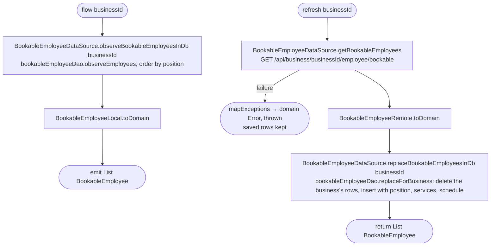

[← Operations](../README.md)

# Get bookable employees

`GetBookableEmployees.flow(businessId)` / `.refresh(businessId)` → `flow` local only (Room `bookable_employee`),
`refresh` via `GET /api/business/{businessId}/employee/bookable` · called by booking's
[Get booking specialists](../booking/get-booking-specialists.md) in the client web app; bound by
`clientEmployeesDomainModule()` with `CommonBookableEmployeeDataSource` from `clientEmployeesDataModule()`

The employees a client can book at a business: every employee who is not suspended, in the backend's order, with
only their name, the services they provide and their schedule (`BookableEmployee`). Any signed-in user may list
them, unlike `GET /api/business/{businessId}/employee`, which needs the employees view permission and returns
contacts and permissions. They are cached in `ClientDatabase`'s `bookable_employee` table and its child tables
(see [Employees](../../database/employees.md#bookable-employees-clientdatabase-only)), so the specialist step shows
the people it found last time at once, also offline, while `refresh` brings the list up to date. `refresh` replaces
the business's rows as a whole, so someone who is no longer bookable disappears. `CommonBookableEmployeeDataSource`
is a `LogOutAction` that clears the table. Its DAO is in `ClientDaos` only, so the mobile app does not install it.

