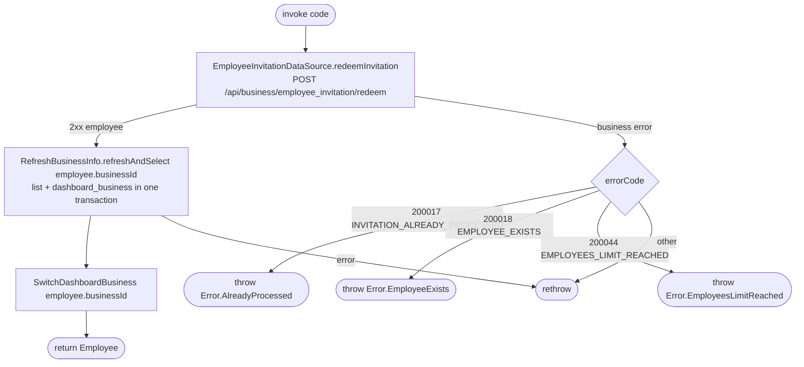

[← Operations](../README.md)

# Redeem employee invitation

`RedeemEmployeeInvitation(code)` → `POST /api/business/employee_invitation/redeem`
· called from [Join business](../business/join-business.md)

After joining, the use case re-syncs the business list selecting the joined business in the same transaction
(`RefreshBusinessInfo.refreshAndSelect`; the new business and the user's grants in it only exist on the server
so far), then calls Switch dashboard business, which only tells the server since the local selection is already
set. The business-error mapping
wraps the *whole* block. If the refresh or the switch fails after a successful redeem, the raw error
propagates, even though the user has already joined.

A business with its limit of active employees (100 unless the backend raises it; suspended employees don't count)
refuses the join with `BUSINESS_EMPLOYEES_LIMIT_REACHED` (200044).

Composes [Refresh business info](../business/refresh-business-info.md) and [Switch dashboard business](../business/switch-dashboard-business.md).
