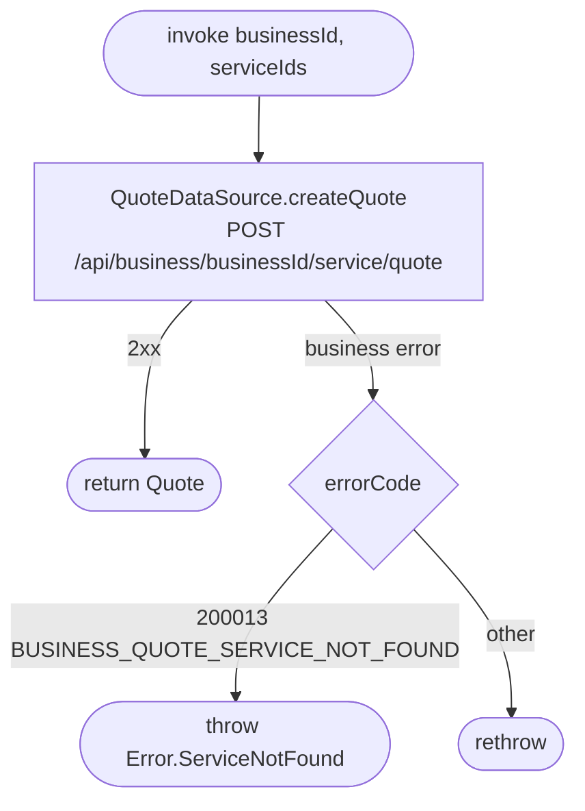

[← Operations](../README.md)

# Create quote

`CreateQuote(businessId, serviceIds)` → `POST /api/business/{businessId}/service/quote`
· called from [Create appointment](../appointments/create-appointment.md)

Asks the server for full current service models and a signed price/duration token for the selected
service ids. Instant booking compares this result with the caller's displayed snapshots before using
the token. Quote retrieval itself persists nothing; mismatch recovery refreshes the service cache in
the booking use case.

