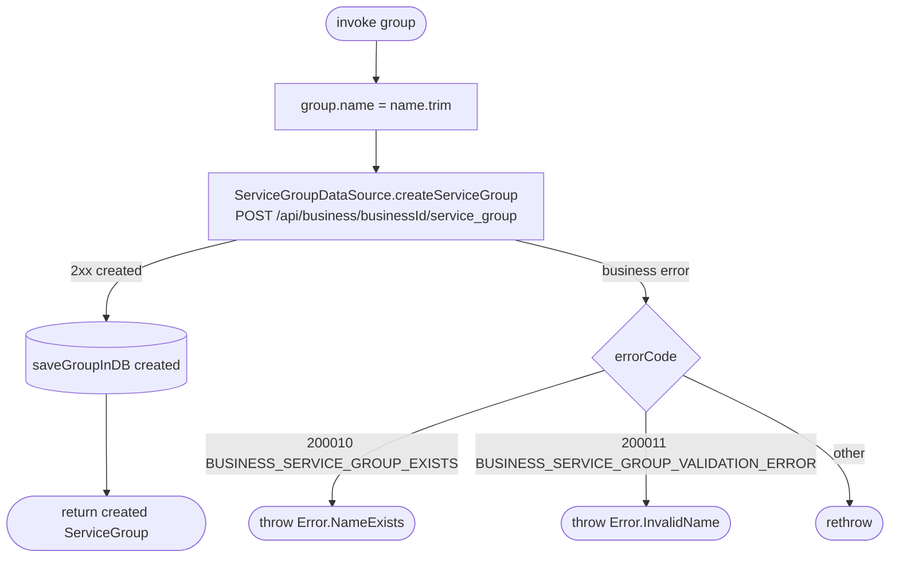

[← Operations](../README.md)

# Create service group

`CreateServiceGroup(group)` → `POST /api/business/{businessId}/service_group`
· called from `ServiceGroupListViewModel`

The group name is trimmed before it is sent.

