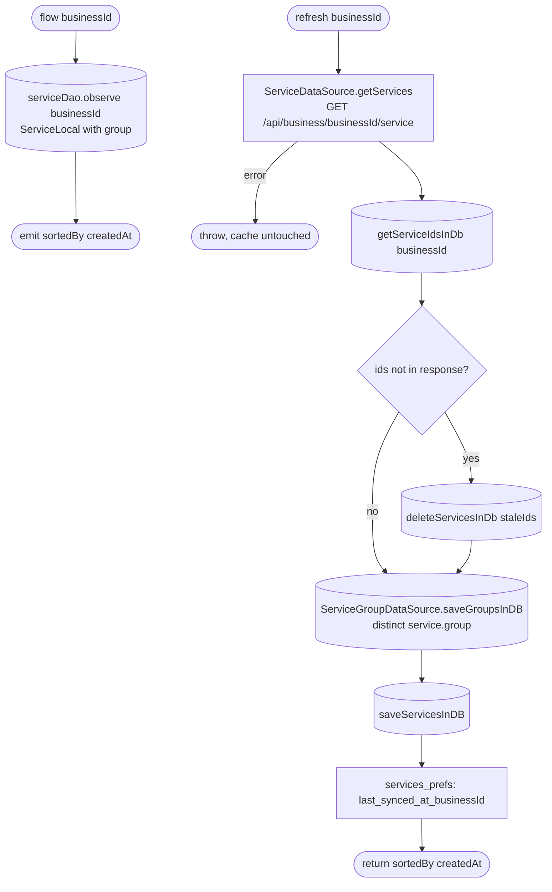

[← Operations](../README.md)

# Get business services

`GetBusinessServices.flow(businessId)` / `.refresh(businessId)` → `GET /api/business/{businessId}/service`
· called from [Get services](get-services.md) (the business app's dashboard business) and
[Get booking catalog](../booking/get-booking-catalog.md) and [Get booking preparation](../booking/get-booking-preparation.md)
(the client web app's services step)

The services of one business, whichever business it is. Any signed-in user may read them, so the client web app
uses the same route as the business app. Before the services are upserted, the distinct groups embedded in the
response are upserted into `service_group`, so the `service.groupId` foreign key always holds. Services missing
from the response are deleted from the cache. The use case returns every service, available or not; callers
filter (the booking use cases leave out unavailable ones).

