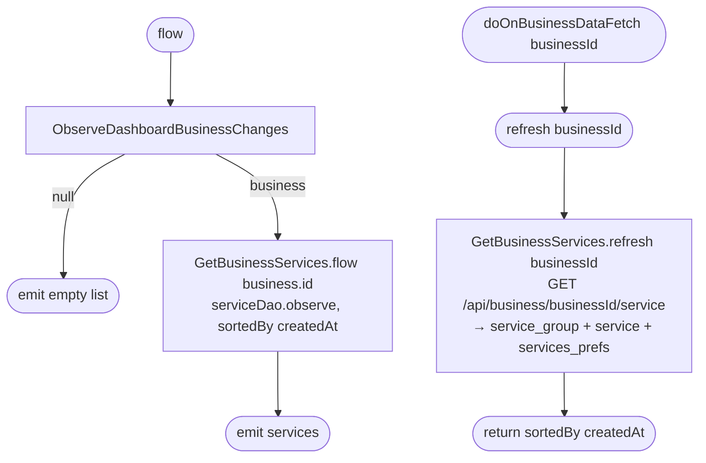

[← Operations](../README.md)

# Get services

`GetServices.flow()` / `.refresh(businessId)` → [Get business services](get-business-services.md)
(`GET /api/business/{businessId}/service`)
· called from `ServiceListViewModel`, [Get appointment options](../appointments/get-appointment-options.md)
and [background data fetch](../authorization/initial-app-data-fetch.md)

The services of the business app's dashboard business. `flow()` follows the dashboard business and switches to
that business's cached services; `refresh` and the `BusinessDataFetchAction` delegate to
[Get business services](get-business-services.md), which fetches, removes stale services and saves the services
with their groups.

