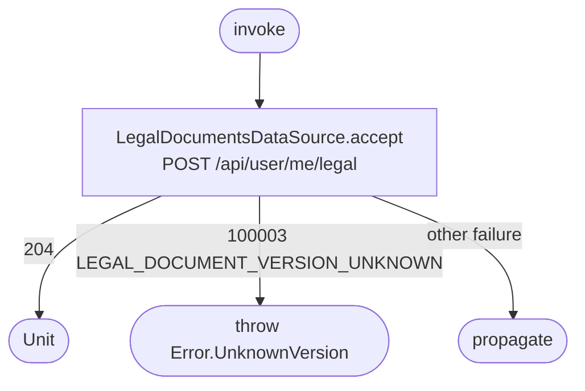

[← Operations](../README.md)

# Accept legal documents

`AcceptLegalDocuments.invoke()` → `POST /api/user/me/legal`. No local cache is read or written.

The caller supplies the exact accepted versions. Null means leave the existing acceptance unchanged;
the operation does not fetch new versions or infer consent. Repeating the same acceptance is idempotent
on the backend. Use `GetLegalDocumentStatuses` to read the fresh status when needed.

The Android and iOS Settings Legal section invokes this operation only after an explicit acceptance tap,
sending the pending versions bound to the current document rows. A short consent explanation accompanies
the “Accept documents” action; opening a document does not record acceptance. Accepted documents are omitted. Success plays a
success haptic and reloads status through `GetLegalDocumentStatuses`. Unknown-version rejection explains
the change and reloads for review without submitting again automatically. Keyed launches deduplicate
concurrent submissions. Visibility and enabled state determine when acceptance can be tapped; the callback
uses the displayed versions without redundant ViewModel guards or a second copy of the status snapshot.
The shared button loading helpers manage submission state. Cached pending documents remain available
when a status refresh fails.
