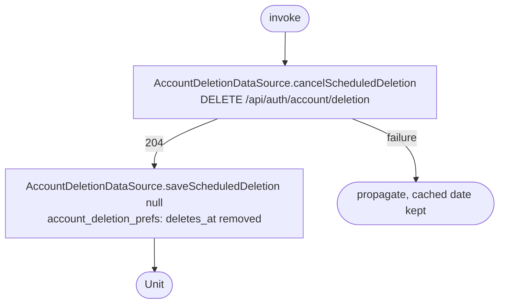

[← Operations](../README.md)

# Cancel account deletion

`CancelAccountDeletion()` cancels the account deletion the person requested, during its 7-day grace period
(backend #208). It needs only the access token: no passkey or Telegram confirmation. The backend answers 204 and
also succeeds when nothing is pending, so a second tap or a deletion already cancelled elsewhere is harmless.
Bound in the mobile apps and the client web app (`sharedSettingsDomainModule`). Called from
`AccountDeletionBannerViewModel`, the strip shown at the bottom of every screen while a deletion is pending.

Removing the cached date makes [Get account deletion](get-account-deletion.md)'s `flow()` emit `null`, so the
strip and Delete account's pending notice disappear without another request. The backend tells the person by
notification that the deletion was cancelled. Nothing is retried automatically.

## The strip

`AccountDeletionBannerViewModel` (settings presentation) renders `GetAccountDeletion.flow()`: while a date is
cached it shows "Account deletion on <date>" (`DateStyle.MEDIUM`, device time zone) with a Cancel button, and
hides itself otherwise. It calls `GetAccountDeletion.refresh()` from its own `onAppResumed()` (not the screen
lifecycle's `onViewPresented`): Android calls it on each `ON_RESUME`, iOS on appear and whenever the scene becomes
active, the Mini App when it mounts and on Telegram's `activated` event. A failed refresh is only logged, except `Error.Unauthorized`: once the grace period
ends the backend erases the account, the token refresh fails and the request answers 401, so the strip adds
`PresentationNotification.Unauthorized`, which signs out through the normal path (`LocalUnauthorizedHandler`, every
`LogOutAction`, back to sign-in). It is often the first request after the app comes back, so the person does not
sit on a dead session. Cancel shows the button's spinner, then on
success the "Deletion cancelled" global message and the success haptic; a failure shows the mapped error and
keeps the strip.

The strip is the design system's `AlertStrip` (Android, iOS and web), an opaque 12% `Error` tint with the
outlined Material `AutoDelete` icon and one ellipsized line. Android passes it to `dashboardGraph` as
`accountNotice`, drawn above the tab bar; iOS adds it to every tab with `safeAreaInset(edge: .bottom)`, with one
ViewModel owned by `DashboardTabs`; the Mini App wraps its `BackStackHost` in `AccountDeletionNotice`, which pins
the strip to the bottom of the page and lifts sticky bottom bars (`RevealingBottomBar`) above it.
