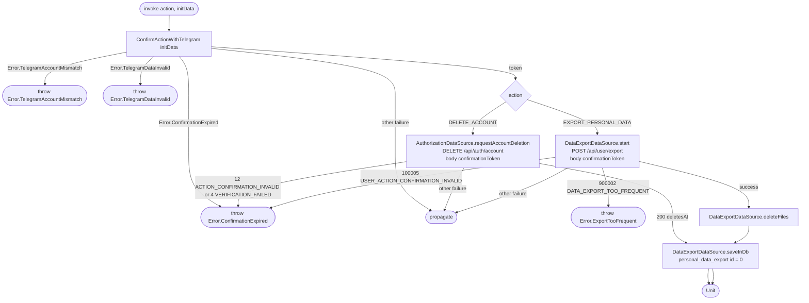

[← Operations](../README.md)

# Complete Telegram confirmation

`CompleteTelegramConfirmation(action, initData)` finishes an account deletion or a personal data export that
the person confirmed in their Telegram chat. It composes `ConfirmActionWithTelegram` and runs the same
protected request as the passkey path, through the shared `AccountDeletionScheduler` and `PersonalDataExportRequest`
helpers. Bound only in the client web app (`clientSettingsDomainModule`) and called from
`ConfirmActionViewModel`, which the Mini App opens for an `op_delete-account_…` or `op_export-personal_…`
launch parameter (parsed by `LaunchParameter.parse` in `:core:domain`).

The deletion is only scheduled: the backend erases the account 7 days later (backend #208) and the
account keeps working until then, so the session is never cleared. A failed confirmation makes no protected
request. Nothing is retried automatically.

There is no confirmation screen: tapping Confirm in the chat is the confirmation. Home pushes
`ClientScreen.ConfirmAction(action)`, which opens Delete account or Export my data directly, and `ConfirmTelegramAction`
on that screen runs `ConfirmActionViewModel` once, which calls this operation with the raw `initData` as soon as it
opens. Both screens render from the local cache, so the saved result shows by itself: Delete account switches to the
requested deletion and its date (see [Get account deletion](get-account-deletion.md)) while the person stays signed
in, and Export my data to its preparing state from `personal_data_export`. Success plays a haptic; an expired or used
confirmation, another Telegram account's confirmation, stale Telegram data (reopen the Mini App from the chat
button) or an export already made today shows its message in a Telegram popup, and other failures show the mapped
error.
