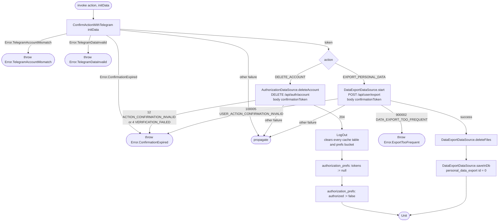

[← Operations](../README.md)

# Complete Telegram confirmation

`CompleteTelegramConfirmation(action, initData)` finishes an account deletion or a personal data export that
the person confirmed in their Telegram chat. It composes `ConfirmActionWithTelegram` and runs the same
protected request as the passkey path, through the shared `AccountRemoval` and `PersonalDataExportRequest`
helpers. Bound only in the client web app (`clientSettingsDomainModule`) and called from
`ConfirmActionViewModel`, which the Mini App opens for an `op_delete-account_…` or `op_export-personal_…`
launch parameter (parsed by `LaunchParameter.parse` in `:core:domain`).

Unlike the passkey path, the deletion makes no `PassKeyManager.signalAccountDeleted` call: there is no passkey
assertion in the Mini App. A failed confirmation makes no protected request and keeps the session. Nothing is
retried automatically.

On success the screen plays a success haptic; a deletion shows the success message and the cleared session
returns the Mini App to Telegram sign-in, an export replaces the screens above Home with Export my data, which
renders the RUNNING status from `personal_data_export`. Each error replaces the Confirm button with "Open
Settings". The Telegram `BackButton` leaves without confirming.
