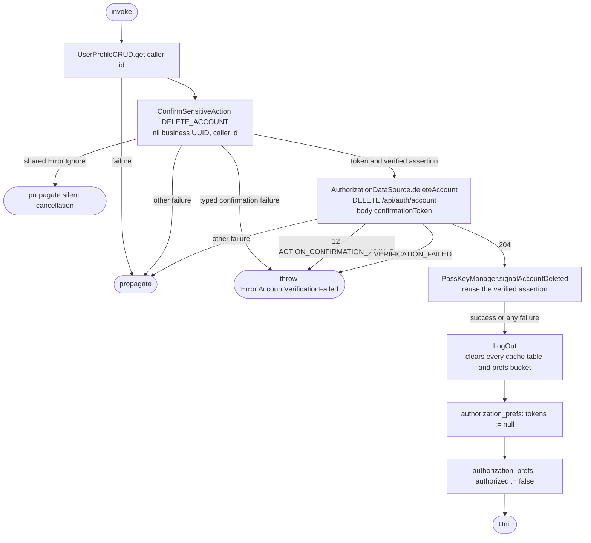

[← Operations](../README.md)

# Delete account

`DeleteAccount()` composes `UserProfileCRUD.get()`, `ConfirmSensitiveAction` and `LogOut`.
Called from `DeleteAccountViewModel`.

The caller confirms `DELETE_ACCOUNT` with the nil business UUID and their own user UUID as target.
The shared confirmation operation obtains the challenge, prompts for a passkey and exchanges its
assertion at `POST /api/auth/passkey/confirm_action`. Account deletion sends only the resulting
`confirmationToken` to `DELETE /api/auth/account`; the assertion itself is not sent to that endpoint.

The confirmation token is single-use and expires after two minutes. Failed or cancelled confirmation
makes no DELETE request. A failure before or during remote deletion preserves the authenticated session
and does not run logout/cache cleanup or signal credential removal. The caller profile read can fill its
normal cache on a miss. No automatic retry of confirmation or the protected DELETE is made.

`signalAccountDeleted` is best-effort: any failure is swallowed because the account is already deleted on the
server. It reads `id` and `response.userHandle` from the assertion JSON and forwards them to
`PasskeyCredentialUpdater`, which each platform supplies through `StateFactoryCreator.createPasskeyCredentialUpdater()`.
Android (`AndroidPasskeyCredentialUpdater`) sends `SignalUnknownCredentialRequest` and
`SignalAllAcceptedCredentialIdsRequest` (empty list) via `CredentialManager.signalCredentialState`. iOS
(`IOSPasskeyCredentialUpdater`, in Swift because `ASCredentialUpdater` is Swift-only) calls
`reportUnknownPublicKeyCredential` and `reportAllAcceptedPublicKeyCredentials` (empty list). The all-accepted
signal is skipped when the assertion has no `userHandle`.

After a successful deletion, [Log out](../authorization/log-out.md) runs every `LogOutAction`. Its `DELETE /api/auth/session`
call fails because the account no longer exists, and that failure is swallowed like any other logout
action error.
