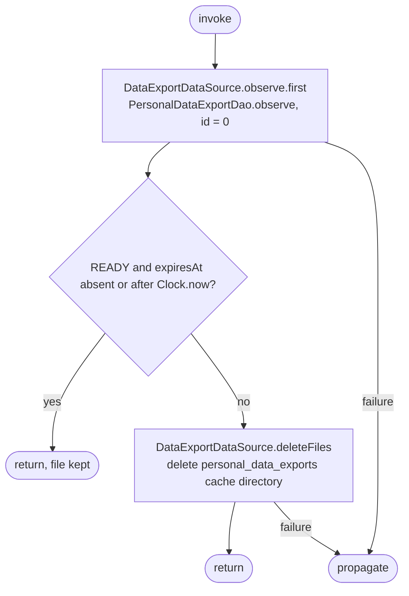

[← Operations](../README.md)

# Delete expired personal data export file

`DeleteExpiredPersonalDataExportFile()` → local only · called from
[Initial app data fetch](../authorization/initial-app-data-fetch.md) `timestampProtectedFetch` on every
app start, before its 30-minute throttle and authorization check.

It removes the downloaded personal data JSON when the cached export can no longer be downloaded, so the
file does not outlive its expiry when the export screen is never reopened or its opening refresh runs
offline. It reads the first value of the cached `personal_data_export` row and deletes the
`personal_data_exports/` cache directory unless that record is READY with a future or absent expiry.
A missing row also deletes the directory. No network request or database write is performed.

The expiry rule is shared with `GetPersonalDataExport` (`isExpiredAt` / `isDownloadableAt` in
`PersonalDataExportAvailability.kt`), so the startup cleanup and the screen agree on when an export
stops being downloadable. `InitialAppDataFetch` wraps the call in `runCatching`, so a file-system
failure never blocks the startup fetch.
